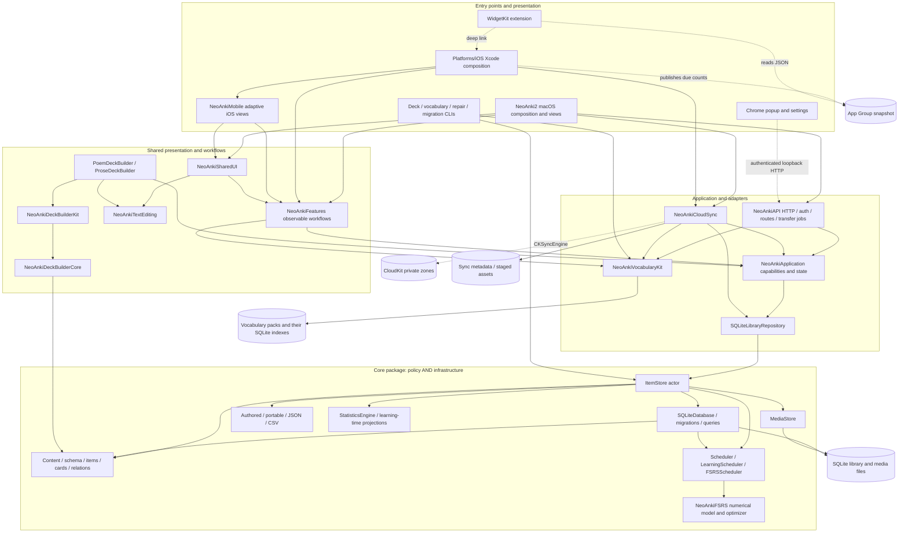
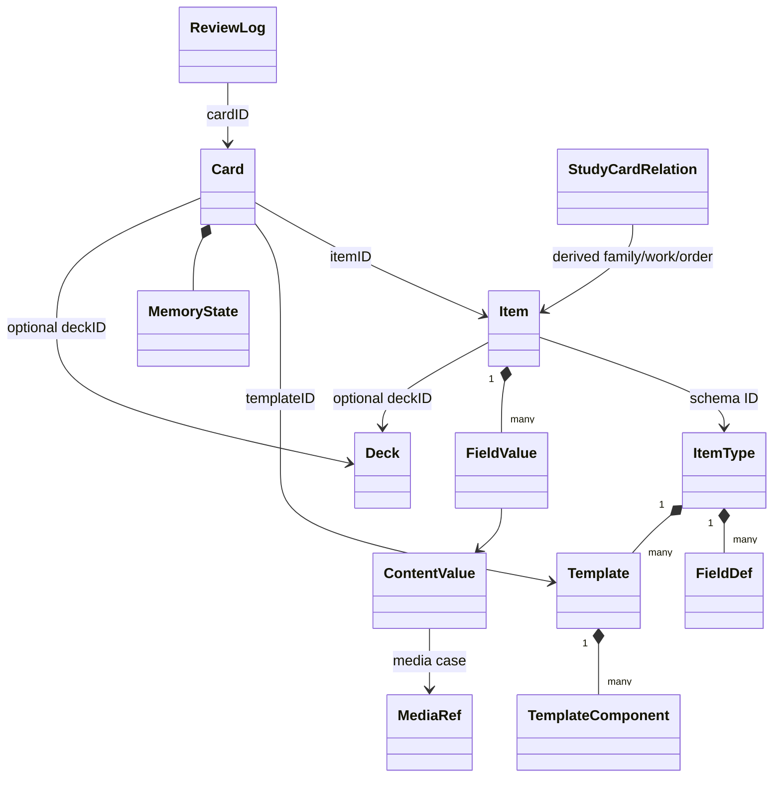
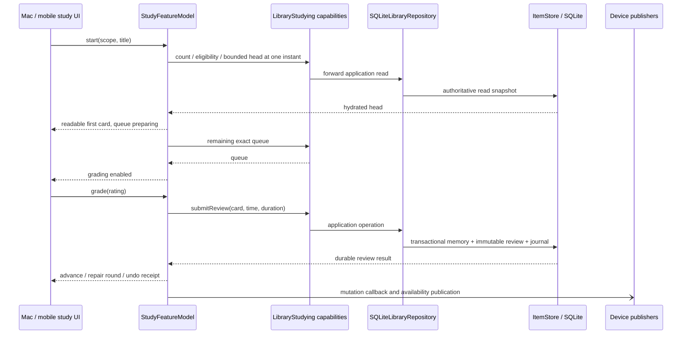
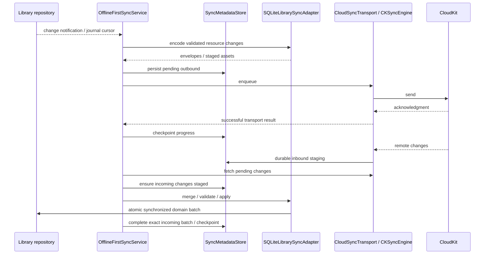
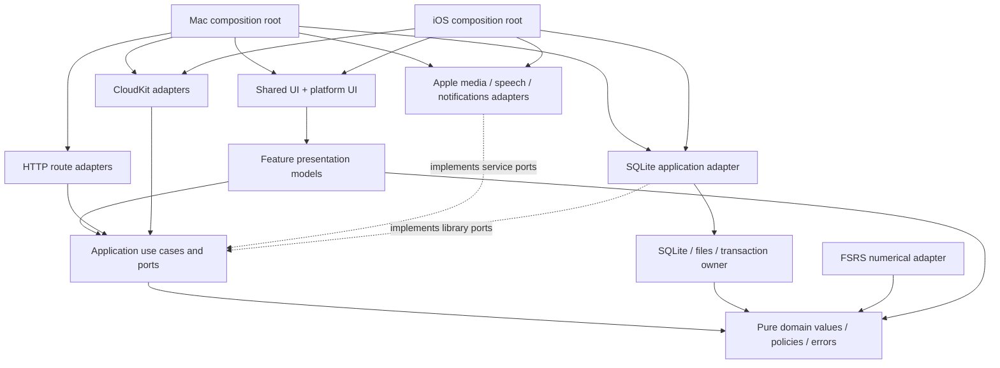

# NeoAnki2 architecture audit and source atlas

**Audit date:** November 17, 2026. **Source revision:** `68cce6aa025837593ac34680163cfb44a3269633`, including the preexisting working-tree edits to `Sources/NeoAnki2/StudyView.swift`, `UITests/NeoAnki2UITests/StudyUITests.swift`, and `docs/user/studying.md`. This audit changes no application code.

**Assessment:** NeoAnki2 has a useful, tested layered architecture. Its strongest boundaries are UI versus shared workflows, capability-based native operations, transport versus library synchronization, and immutable content/scheduling values. It does **not** have a fully isolated Clean Architecture domain: `NeoAnkiCore` combines domain policy, database implementation, media storage, imports, and application orchestration. The highest-value improvements are to make domain relationships explicit, make feature capabilities honest and visible, and separate policy from persistence incrementally. A rewrite would discard working transaction and recovery guarantees.

## Explore the system

- [Interactive source atlas](explorer.html): whole-system overview, every declared target's incoming/outgoing dependencies, searchable Swift types/functions/properties, declaration hierarchy, signatures, and source reference occurrences. Self-contained, offline, with no external scripts or network requests.
- [All-target dependency diagram](all-targets.mmd): complete SwiftPM target declarations, Xcode target relationships, Mac packaging shell dependency, and the Chrome HTTP connection.
- [Per-module UML-like class diagrams](types/NeoAnkiCore.mmd): one Mermaid file per module in `types/`, including named types, extensions, direct member names, and same-module declared conformance/inheritance candidates. The atlas supplies full signatures and cross-module navigation.
- [All Swift declarations](symbols.tsv): an untruncated, sortable inventory with module, file, start/end line, kind, qualified name, local-scope flag, and signature.
- [Full Swift declaration/reference inventory](swift-inventory.json.gz): every scanned declaration and reference occurrence, including tests and local bindings.
- [Target and import edges](module-dependencies.json), [type-reference candidates](type-dependencies.json), [full type graph for GraphML tools](all-types.graphml), [metrics](metrics.json), [all tracked files and hashes](files.tsv), and [supporting-language declarations](supporting-symbols.json).

The diagrams below explain responsibilities. The generated target diagram and inventories carry the exhaustive structural detail; they are not reduced to a handful of representative classes.

## Scope, method, and limits

The scan parsed **488 tracked Swift files**, including both Swift packages, both app shells, the widget, tools, test support, and test suites. Of these, **278 production/tool Swift files contain 87,116 physical lines**, excluding `NeoAnkiTestSupport` and test directories. It found **28,926 Swift declaration records** across the repository, including **17,002 in production/tools**, and **291,035 syntactic reference occurrences**. Production includes **72 classes, 34 actors, 752 structs, 326 enums, 56 protocols, and 3,374 explicit `func` declarations**. Nested/local declarations are included in those totals. Properties, initializers, enum cases, extensions, aliases, and deinitializers are also inventoried.

The dependency model contains **43 components**: 37 SwiftPM targets, five Xcode targets, and the Chrome companion. `files.tsv` catalogs all tracked files, including non-Swift source, assets, schemas, configuration, CI, release scripts, and documentation. Python supporting declarations use Python's AST; the shell/JavaScript appendix uses named-declaration patterns and does not claim complete JavaScript callback/method coverage. Chrome's four production JavaScript files were also read to trace their responsibilities.

The Swift scanner uses Xcode's bundled SwiftSyntax/SwiftParser, rather than a regex approximation. It reported **zero Swift syntax errors**. It includes inactive `#if` branches, private declarations, local bindings, and functions inside extensions. A multi-binding `let`/`var` is one declaration record. Parameters remain in signatures; anonymous closures, synthesized members, and individual property accessors are not separate declaration records. A few tracked standalone Swift build/documentation scripts are included in the all-source inventory, outside the production count.

**“All dependencies” has several meanings.** This atlas separates them:

| Relationship | Evidence | Confidence / limitation |
| --- | --- | --- |
| Declared Swift target dependency | `swift package dump-package` for both packages | Exact for the checked manifests, including test and tool targets |
| Declared Xcode product/target dependency and source membership | Parsed `project.pbxproj` objects | Exact recorded metadata; Mac packaging's explicit Swift build phase is included separately |
| Imported module/framework | `ImportDeclSyntax` in every Swift file | Exact source declaration; union of conditional branches, including inactive platforms |
| Named type and function/reference occurrence | SwiftSyntax expression/type nodes with enclosing declaration and line | Exact syntax occurrence; **not** compiler overload/type resolution |
| Candidate type-to-type dependency | Unique visible-module name matching of type syntax | Useful navigation, explicitly heuristic; ambiguous matches are omitted |
| Runtime dependencies and data movement | Manual tracing of composition, persistence, cloud, HTTP, widget, and browser paths | Evidence-backed static interpretation; no live account/device/network observation |

Possible callers in the atlas match spelling and can include unrelated overloads. Neither they nor `type-dependencies.json` prove call reachability, dead code, protocol-dispatch targets, synthesized behavior, or all concurrency interleavings. The inventory is exhaustive within the stated syntax categories; this is not an exhaustive semantic review of every function body. Findings below come from focused examination of boundaries and substantial workflows, with exact source locations. No GUI, desktop interaction, app launch, publication, or installation was performed.

## Whole-system component and deployment map

Solid arrows below mean a source-level dependency or capability use. Dotted arrows identify runtime protocols/data exchange. The all-target diagram separately lists every manifest edge, including direct Core imports omitted from this overview for readability.



`App --> Repo` represents the present target's contents, not the desired direction of pure application policy. Protocols and `SQLiteLibraryRepository` compile in the same target. `Sync --> Repo` is concrete in `SQLiteLibrarySyncAdapter`. Direct outer-to-domain dependencies are legitimate; the problem is that importing today's Core also imports its storage implementation dependency surface.

## Layer and component catalog

Counts below are generated from source. Types include nested nominal declarations; function counts count explicit `func`, not initializers, properties, or closures. Zero source files in the Mac Xcode wrapper is intentional: it packages the SwiftPM executable through a shell phase.

| Target / component | Swift files | Nominal types | Functions | Lines |
| --- | ---: | ---: | ---: | ---: |
| `NeoAnkiTextEditing` | 3 | 20 | 40 | 523 |
| `NeoAnkiTextEditingTests` | 1 | 1 | 16 | 248 |
| `NeoAnkiFeatures` | 13 | 55 | 229 | 4,154 |
| `NeoAnkiMobile` | 17 | 65 | 154 | 5,459 |
| `NeoAnki2` | 61 | 170 | 505 | 14,633 |
| `NeoAnkiApplication` | 16 | 122 | 510 | 4,502 |
| `NeoAnkiSharedUI` | 23 | 115 | 227 | 8,080 |
| `NeoAnkiCloudSync` | 9 | 18 | 127 | 2,505 |
| `NeoAnkiDeckBuilderKit` | 1 | 2 | 4 | 70 |
| `NeoAnkiDeckBuilderCore` | 1 | 7 | 6 | 121 |
| `NeoAnkiAPI` | 9 | 149 | 275 | 9,307 |
| `NeoAnkiVocabularyKit` | 8 | 43 | 92 | 2,479 |
| `NeoAnkiVocabularyCLI` | 1 | 3 | 10 | 220 |
| `neoanki-vocab` | 1 | 1 | 1 | 10 |
| `NeoAnkiAPIReferenceGenerator` | 1 | 2 | 13 | 308 |
| `neoanki-chrome-fixture` | 1 | 3 | 3 | 86 |
| `NeoAnkiTemplateMigration` | 1 | 10 | 17 | 401 |
| `NeoAnkiTemplateMigrator` | 1 | 2 | 4 | 55 |
| `NeoAnkiPoemRepair` | 1 | 4 | 8 | 293 |
| `PoemDeckBuilder` | 6 | 19 | 32 | 1,231 |
| `ProseDeckBuilder` | 6 | 19 | 30 | 1,235 |
| `NeoAnkiFeaturesTests` | 20 | 60 | 418 | 5,913 |
| `NeoAnkiApplicationTests` | 17 | 39 | 261 | 4,398 |
| `NeoAnki2Tests` | 58 | 35 | 427 | 9,535 |
| `NeoAnkiAPITests` | 2 | 6 | 102 | 4,680 |
| `PoemDeckBuilderTests` | 1 | 1 | 23 | 738 |
| `ProseDeckBuilderTests` | 1 | 0 | 10 | 251 |
| `NeoAnkiVocabularyKitTests` | 4 | 5 | 52 | 1,101 |
| `NeoAnkiVocabularyCLITests` | 1 | 0 | 3 | 79 |
| `NeoAnkiFSRS` | 8 | 35 | 54 | 1,436 |
| `NeoAnkiCore` | 84 | 356 | 984 | 29,244 |
| `NeoAnkiTestSupport` | 8 | 14 | 41 | 738 |
| `NeoAnkiDeckCLI` | 1 | 1 | 5 | 151 |
| `NeoAnkiFSRSBenchmark` | 1 | 2 | 5 | 101 |
| `NeoAnkiCoreTests` | 58 | 23 | 577 | 13,158 |
| `NeoAnkiFSRSTests` | 4 | 11 | 27 | 456 |
| `NeoAnkiFlowTests` | 14 | 0 | 52 | 1,413 |
| `NeoAnkiiOS [Xcode]` | 3 | 10 | 35 | 430 |
| `NeoAnki2Widget [Xcode]` | 1 | 7 | 4 | 82 |
| `NeoAnki2MobileUITests [Xcode]` | 1 | 19 | 80 | 2,255 |
| `NeoAnkiMac [Xcode]` | 0 | 0 | 0 | 0 |
| `NeoAnki2UITests [Xcode]` | 16 | 11 | 297 | 6,836 |
| `Chrome Companion` | 0 | 0 | 0 | 0 |

| Component | Responsibility and important collaborators |
| --- | --- |
| `NeoAnkiCore` | Content/schema/model values; validation and card generation; scheduling adapters; ItemStore/SQLite/media persistence; study sessions and response storage; statistics; authored/portable import-export. The broadest dependency hub. |
| `NeoAnkiFSRS` | Native numerical model, reference parameters, datasets, optimizer, initialization and evaluation. Core's `FSRSScheduler` adapts it to memory/timestamp policy. |
| `NeoAnkiApplication` | Capability protocols, repository adapter, native command receipts/outcomes, revision-aware reads, session/navigation state, editor drafts, context contracts, device-service contracts, sync contracts. |
| `NeoAnkiFeatures` | Shared observable study, library, item-type, statistics, saved-response, word-capture and contextual-authoring workflows. Also contains Apple generation/speech implementations and local context-source infrastructure. |
| `NeoAnkiSharedUI` | Adaptive study stage, answer review, authoring, card setup, image occlusion, statistics charts, dictionary/cloud lists, sync presentation, shared design tokens. |
| `NeoAnkiTextEditing` | Draft protection and text undo/focus/shortcut routing, including native platform text-editor bridges. This is a presentation component, not a domain package. |
| `NeoAnki2` | macOS app lifecycle/composition, AppKit panels/editors/media, windows/commands, library/browse adapters, preferences, local API control and pairing, cloud setup. |
| `NeoAnkiMobile` | iOS adaptive navigation and screens, editors, study presentation, vocabulary presentation and platform-specific test hosts. Its source directory is named `NeoAnkiIOS`; it does not own the shipping `@main`. |
| `NeoAnkiiOS [Xcode]` | Shipping `@main`, paths, notifications, background refresh, app badge, App Group publisher, sync composition, lifecycle/push handling and entitlements. |
| `NeoAnki2Widget [Xcode]` | Independently decoded, privacy-limited due-count snapshot. No library database dependency. Launches the app through deep links. |
| `NeoAnkiCloudSync` | `OfflineFirstSyncService`, `CKSyncEngineTransport`, `SQLiteLibrarySyncAdapter`, merge policy, durable metadata, separate statistics/learning-time streams, dictionary cloud transport. |
| `NeoAnkiAPI` | Network HTTP adapter, pairing/authorization, DTOs/errors, typed endpoint registry/OpenAPI generation, route execution, sessions, idempotency, staged transfer jobs and vocabulary facade. |
| `NeoAnkiVocabularyKit` | Lexical values, validated pack format/compiler, installed pack catalog, SQLite lookup, dictionary lookup state, chunked cloud-transfer contracts and model. Deliberately independent of the library database. |
| `NeoAnkiVocabularyCLI` / `neoanki-vocab` | Headless pack compilation, inspection and search. The tiny executable forwards to the reusable command implementation. |
| `NeoAnkiDeckBuilderCore` | UI-free descriptors, host context, workspace/bundle lifetime compatibility, typed prepared deck creation and command identity. |
| `NeoAnkiDeckBuilderKit` | SwiftUI `AnyView` feature erasure and registry. Its small UI dependency is outside the builder contracts. |
| `PoemDeckBuilder` / `ProseDeckBuilder` | Source parsing/plans, draft production, prepared Core compilation, legacy materialization, native builder views and existing-deck reconciliation. Intentionally separate text semantics. |
| `NeoAnkiTemplateMigration` / migrator executable | Explicit historical template-definition migration and its command-line adapter; separate from normal app startup. |
| `NeoAnkiPoemRepair` | Explicit repair tool using API DTOs, poem builder rules and Core. Not a normal app workflow. |
| `NeoAnkiDeckCLI` | Standalone authored/portable deck operations over Core. |
| Reference generator / FSRS benchmark | Developer-only generated HTTP reference and numerical benchmark entry points. |
| Chrome companion | `popup.js` owns capture/form orchestration; `settings.js` owns pairing/settings; `core.js` owns client/draft/dictionary logic; `storage.js` serializes durable extension storage. Uses active-tab scripting, trusted extension storage, and loopback HTTP. |
| Test fixtures and test support | `neoanki-chrome-fixture`, `NeoAnkiTestSupport`, Swift unit/flow/contract suites, Chrome unit/integration tests, isolated XCTest UI suites. Compiled test-host helpers remain in production-target counts; their filenames identify their fixture role. |
| Build/release/docs infrastructure | Xcode wrappers, `Scripts`, GitHub Actions, signing/Store/Homebrew/deployment controllers, API reference generation, documentation feature/claim validation and assets. Cataloged in `files.tsv`; not assigned domain-layer responsibilities. |

## Important classes and relationships

This is a deliberately readable selection. The generated `types/*.mmd` files and source atlas include the remaining classes, structs, actors, protocols, functions, and properties.

```mermaid
classDiagram
    class LibraryBrowsing { <<protocol>> }
    class LibraryStudying { <<protocol>> }
    class LibraryStudyResponses { <<protocol>> }
    class LibraryChangePersisting { <<protocol>> }
    class LibraryRepository { <<aggregate>> }
    class LocalAPILibrary { <<protocol>> }
    class SQLiteLibraryRepository { <<actor>> }
    class ItemStore { <<actor>> }
    class SQLiteDatabase
    class MediaStore { <<actor>> }
    class StudyFeatureModel { <<MainActor>> }
    class StudyModel { <<adapter>> }
    class LibraryFeatureModel { <<MainActor>> }
    class NativeLibraryReadCoordinator { <<actor>> }
    class NeoAnkiAPIService { <<actor>> }
    class NeoAnkiLocalAPIServer { <<actor>> }
    class Scheduler { <<protocol>> }
    class FSRSScheduler
    class OfflineFirstSyncService { <<actor>> }
    class CloudSyncTransport { <<protocol>> }
    class LibrarySyncAdapter { <<protocol>> }
    class CKSyncEngineTransport { <<actor>> }
    class SQLiteLibrarySyncAdapter { <<actor>> }
    LibraryBrowsing <|-- LibraryRepository
    LibraryStudying <|-- LibraryRepository
    LibraryStudyResponses <|-- LibraryRepository
    LibraryChangePersisting <|-- LibraryRepository
    LibraryRepository <|-- LocalAPILibrary
    LocalAPILibrary <|.. SQLiteLibraryRepository
    StudyModel --> StudyFeatureModel
    StudyFeatureModel --> LibraryBrowsing
    StudyFeatureModel --> LibraryStudying
    StudyFeatureModel --> LibraryStudyResponses
    StudyFeatureModel --> MediaStore : concrete media handle
    LibraryFeatureModel --> LibraryRepository : public aggregate
    LibraryFeatureModel --> NativeLibraryReadCoordinator
    NativeLibraryReadCoordinator --> LibraryBrowsing
    NeoAnkiLocalAPIServer --> NeoAnkiAPIService
    NeoAnkiAPIService --> LocalAPILibrary
    SQLiteLibraryRepository --> ItemStore
    ItemStore --> SQLiteDatabase
    ItemStore --> MediaStore
    ItemStore --> Scheduler
    Scheduler <|.. FSRSScheduler
    OfflineFirstSyncService --> LibraryChangePersisting
    OfflineFirstSyncService --> CloudSyncTransport
    OfflineFirstSyncService --> LibrarySyncAdapter
    CloudSyncTransport <|.. CKSyncEngineTransport
    LibrarySyncAdapter <|.. SQLiteLibrarySyncAdapter
    SQLiteLibrarySyncAdapter --> SQLiteLibraryRepository
```



`LibraryRepository` refines 12 capability protocols, not only the four illustrated. Additional capabilities such as native receipts, generated-deck creation, statistics, learning time, editing safeguards, and Studio saving are separately discovered or passed. This preserves source compatibility, but the actual capabilities required by a workflow are not always evident in its parameter type.

Domain identity is mostly clean:



The ID links are associations, not necessarily retained object references. `ContentValue` is a closed native sum type; adding a new content representation legitimately requires coordinated compiler-checked changes in validation, rendering, interchange and storage.

## End-to-end flows and transaction boundaries

### Native study



Evidence: `StudyFeatureModel.swift:171,451,508`; `StudyModel.swift:10`; `LibraryRepository.swift:118`; `ItemStore.swift`. Native queue repair/undo and the HTTP reservation/session lifecycle are different state machines. They should share grading and eligibility policy, but should not be merged merely because both study cards. Saved audio submissions are explicitly separated from graded reviews (`LibraryStudyResponses`, `LibraryRepository.swift:203`).

### Native generated-deck creation

```mermaid
sequenceDiagram
    participant View as Poem / prose builder
    participant Draft as AuthoredDeckDraft
    participant Compile as Core semantic compiler
    participant Prepared as PreparedAuthoredDeck
    participant Cmd as NativeLibraryCommands
    participant DB as ItemStore / SQLite transaction
    View->>Draft: typed source plan
    Draft->>Compile: validate semantics and encoded limits
    Compile-->>Prepared: opaque prepared package
    Prepared->>Cmd: operation identity and parent placement
    Cmd->>DB: create prepared deck
    DB->>DB: schemas + ownership + identities + items + cards + receipt
    DB-->>Cmd: durable result
    Cmd-->>View: success; postcommit refresh warnings stay warnings
```

This path already exists following ADR 0004. Recommending removal of a native JSON/temp-file round trip would be stale advice: the ordinary native path was changed before this audit. Legacy bundle/workspace APIs intentionally remain adapters for explicit materialization and compatibility (`DeckBuilderKit.swift`, `NativeLibraryCommands.swift:164–201`, `AuthoredDeckDraft.swift`, both builders).

### Offline-first library synchronization



Evidence: `OfflineFirstSyncService.swift`, `CKSyncEngineTransport.swift`, `SyncMetadataStore.swift`, `SQLiteLibrarySyncAdapter.swift:123–161`. The initial merge additionally backs up and verifies the library, resolves cross-library identity/schema aliases, and preserves conflict copies. Statistics and learning-time events use independent immutable streams; vocabulary packs use content-addressed chunk transfer. These are distinct consistency policies, not gratuitous duplicates of one generic sync algorithm.

### Browser / local HTTP API

Chrome captures selected page text through `activeTab`/`scripting`; the page does not receive the API token. Popup/settings use trusted extension-local storage and `makeAPI`, with origin-bound pairing, authorized scopes, revision headers, and persisted pending body/idempotency identity for uncertain saves. Requests go to `NeoAnkiLocalAPIServer` → `NeoAnkiAPIService` → `LocalAPILibrary` → repository/Core. API transfer jobs additionally persist staging and completion state. HTTP review sessions reserve cards independently from native in-memory study sessions.

The HTTP service first looks up typed endpoint metadata, but executes a separate method/path dispatch. Its registry is a valuable contract inventory; it is not yet the sole executable routing definition (`APIEndpointRegistry.swift:52`, `NeoAnkiAPIService.swift:172–235`).

### Storage and privacy boundaries

| State | Owner / dependency | Architectural consequence |
| --- | --- | --- |
| Library, cards, reviews, schema and domain journal | Core `ItemStore` / `SQLiteDatabase` | One authoritative transactional boundary; preserve atomic writes and consistent read snapshots |
| Content-addressed media and reservations | Core `MediaStore`, reference counts in SQLite | File staging and database adoption must remain coordinated |
| Sync engine metadata, outbox, inbound staging, conflict copies | `SyncMetadataStore`, separate from library tables | Recovery survives interrupted transport without making CloudKit authoritative |
| Dictionary packs and pack lookup indexes | VocabularyKit | Separate bounded context, independent of domain-library schemas |
| HTTP import/export job state | API facade plus repository-provided transfer state location | Durable replay is useful; transfer-file location currently leaks into the library boundary |
| Mobile preferences / notifications | Platform services | Device-specific choices stay outside synchronized domain state |
| Widget due counts | App Group JSON snapshot, independently decoded by widget | Good process/privacy isolation; duplicated DTO schema requires a compatibility contract |
| Recorded learner responses | Core local response/media store | Sync adapter intentionally excludes private-only response assets |

## Clean Architecture: where it holds and breaks

The criterion is source dependency direction and separation of policy from mechanism. Runtime calls may travel outward through interfaces while source dependencies remain inward. This follows Martin's [Dependency Rule](https://blog.cleancoder.com/uncle-bob/2012/08/13/the-clean-architecture.html); the existing target graph's acyclicity alone is insufficient to establish it.

| Boundary | Assessment | Evidence and implication |
| --- | --- | --- |
| UI frameworks outside application contracts | **Holds for the enforced import rule** | Architecture checks reject SwiftUI/AppKit/UIKit/CloudKit in Application and Features. The full gate passed. SwiftUI rendering stays in presentation targets. |
| Shared use cases behind capabilities | **Mostly holds** | Study and item-type feature models receive composed protocols. Native atomic operations and read coordination have an application boundary. |
| Pure domain isolated from persistence | **Breaks at target granularity** | Core includes `SQLiteDatabase`, `Schema`, `ItemStore`, `MediaStore`, `PortableDeck`, statistics persistence and pure values. Higher-level clients cannot import domain values without the same target containing SQLite implementation and its dependency. |
| Application independent of concrete data adapters | **Partially holds** | Consumers usually see protocols, but `SQLiteLibraryRepository` is in the same target as them (`LibraryRepository.swift:612`). HTTP is forbidden to name storage types, yet adding an alternative adapter still involves a contract module coupled to today's Core/storage target. |
| Domain independent of feature-specific encoding | **Breaks** | `StudyCardRelation.family(for:)` decodes `neoanki-context-example` JSON; SQLite derives work order from “Poem Line”/“Prose Unit” and particular field names; study refresh also checks “Prose Unit.” See F1 below. |
| Platform implementation injected into workflows | **Partial** | Device-service protocols are explicit, but Features contains AVFoundation/FoundationModels/NaturalLanguage providers and file-backed context infrastructure. Application's image preparation uses ImageIO/UTType. These are reusable across Apple platforms, but they are infrastructure, not pure use-case policy. |
| Transport independent of storage details | **Good boundary with remaining leaks** | API uses `LocalAPILibrary`; sync uses transport/adapter protocols. `LocalAPILibrary` still requires validation snapshots and a transfer-state URL; `SQLiteLibrarySyncAdapter` appropriately names SQLite but directly depends on its concrete repository. |
| Separate process boundary for widget | **Holds** | Widget has no package dependency on Core and reads only an App Group snapshot (`NeoAnkiWidget.swift:28`). |
| Composition roots are thin | **Mixed** | Assembly is centralized, but Mac/iOS roots contain test routing, seed/lifecycle branches, startup paths and sync setup. “Thin composition root” in the architecture prose overstates the present state. |

A source file can be domain-oriented even inside Core; the finding concerns the lack of a compiler-enforced boundary around those files. Similarly, using Foundation, UUID, Date, Codable or Swift Observation is not automatically a violation. The important test is whether changing infrastructure or a feature-specific representation forces changes to stable policy.

## SOLID assessment

### Single Responsibility Principle: mixed, with concrete hotspots

The useful question is which independent policies or stakeholders cause a module to change, rather than whether every class has one method. Martin's [SRP explanation](https://blog.cleancoder.com/uncle-bob/2014/05/08/SingleReponsibilityPrinciple.html) frames responsibility in terms of reasons for change.

**Holds:** `CardGenerator` generates cards from schema/content; `Scheduler` models one scheduling capability; `NativeLibraryReadCoordinator` owns read demand/cursor consistency; `StudyModel` adapts shared native state instead of maintaining another queue; the DeckBuilderCore/Kit split keeps `AnyView` out of builder contracts.

**Breaks or strains:**

- `SQLiteDatabase.swift` is **8,480 lines** and owns migrations, SQL access, study eligibility/order, feature inference, imports, identity reconciliation, reviews and derived projections. SQL-specific eligibility can remain here, but the policy it implements should have an explicit independent specification.
- `NeoAnkiAPIService.swift` is **4,589 lines** and combines authorization orchestration, request/shape validation, routing, paging, deck impact plans, study sessions, transfer recovery and media/vocabulary endpoints. Its `route` is **538 lines** (`:172`).
- `StatisticsEngine.snapshot` is **559 lines** (`StatisticsEngine.swift:29`), covering identity normalization, scope filtering, time attribution, many aggregates and output assembly. It is pure, which is good; purity alone does not make a function cohesive.
- `LibraryFeatureModel` combines library projection/navigation, writes, study launch, sync state, reminders, badge/widget publication and deprecated item-type adapters (`:29–667`). It publicly exposes `library` (`:77`).
- `StudyFeatureModel` is a useful shared coordinator, but also owns answer inputs/evaluation, queue phases/repair, grade/undo, response submission and time tracking (`:48–750`). Extract stable state transitions and policies without creating another mutable queue owner.
- `CardSetupEditorView.swift` is **3,197 lines**. It is presentation-layer code, so its size is not itself a layer violation; state/editing policies and cohesive panels deserve separate ownership.

### Open/Closed Principle: strong extension seams, weak feature semantics

**Holds:** `Scheduler`, context-provider protocols, CloudSyncTransport, import adapters, builder feature erasure/registry and device-service protocols allow replacement or extension. Data-defined fields/templates let new ordinary subjects work without new Swift classes.

**Breaks:** recognizing ordered work under a different type-name/field convention or a different context-family envelope requires a matching adapter or changes to the existing Core inference. A new builder reusing the recognized conventions need not require a Core change. Endpoint additions require coordinated handler identity/metadata and separate method/path dispatch edits. Native application capability expansion increasingly adds runtime refinements and compatibility branches.

A new `ContentValue`/interaction case is not automatically an OCP defect. A closed algebraic data type with exhaustive switches is a sound choice when the set of representations is intentionally owned by the app. Do not replace it with runtime plugins merely to eliminate switch statements.

### Liskov Substitution Principle: useful seams, incompletely specified behavior

There is little app-owned implementation inheritance; the relevant substitutions are protocol conformers. Production SQLite behavior is not interchangeable with every default conformer in every workflow:

- `LibraryBrowsing.cardMaturityDetails` defaults to `[]` (`LibraryRepository.swift:32`).
- `LibraryStudying.reviewSchedulePreviews` defaults to `[:]` (`LibraryRepository.swift:560`).
- `LibraryChangePersisting.changeNotifications` defaults to a completed stream and `verifyBackup` checks only that a nonempty regular file exists (`:409–417`). Production verification is stronger.
- `LibraryCoordinatedItemEditing` has default implementations that always throw unsupported-operation errors (`:436–465`). Refusing unsafe non-atomic emulation is correct, but conforming does not guarantee support.
- `LocalAPILibrary.cardMaturityStatus` supplies a coarse fallback, rather than production maturity policy (`LocalAPILibrary.swift:136`).

These are **behavioral contract risks**, not proof that a presently exercised production substitution crashes. A protocol allowing “unsupported” can be valid if consumers handle it. The weakness is that support, guarantees and observation semantics are implicit. Make capability availability explicit, remove success-shaped absence when information is unknown, and run shared behavioral contracts against every supported conformer. Do not simply delete fallbacks that keep existing integrations working.

### Interface Segregation Principle: good native foundations, aggregate escape routes

**Holds:** browsing, studying, saved responses, scheduling, transfers, editing safeguards and device services are separate protocols. `StudyFeatureModel` requests three explicit library capabilities rather than every repository operation (`StudyFeatureModel.swift:108,122`). Studio saving is separated from historical editing safeguards.

**Breaks/strains:** `LocalAPILibrary` refines the 12-capability aggregate and adds HTTP sessions, idempotency, records/media, validation and transfer storage. `LibraryFeatureModel.library` exposes the aggregate to presentation. Several operations accept `any Sendable` or smaller interfaces, then cast for required behavior. A consumer's initializer type therefore understates its actual dependencies.

Use feature-sized protocol compositions or small dependency structs; an aggregate can remain a composition-root convenience. A concrete repository implementing many small interfaces is fine. Passing that aggregate everywhere is the problem.

### Dependency Inversion Principle: holds at the outer seam, weak inside it

**Holds:** feature models usually depend on application-owned capabilities. `OfflineFirstSyncService` depends on `LibraryChangePersisting`, `LibrarySyncAdapter`, and `CloudSyncTransport`; Core does not import CloudKit. Scheduler behavior is injected through a protocol.

**Breaks/strains:** application contracts share a target with SQLite implementation; domain and persistence share Core; feature models receive a concrete `MediaStore`; feature infrastructure is constructed inside a target meant to house reusable workflows. `SQLiteLibrarySyncAdapter` depending on a concrete SQLite repository is acceptable for a consciously SQLite-specific adapter, but composition should not force the sync policy onto that concrete type.

The improvement is real source dependency separation and appropriately owned ports, not adding a protocol to every struct or wrapping every forwarding method in another service.

## Prioritized architectural findings

### F1 — Make study relationships explicit instead of inferring feature identity

**Priority:** high. **Principles:** OCP, DIP, domain isolation. **Confidence:** high for source coupling. Confirmation witness W1 now reproduces name-dependent ordinal refresh; SQLite work reconstruction remains established by source inspection, rather than a new end-to-end rename journey.

`SQLiteDatabase.refreshStudyRelationsIfNeeded` (`:175–238`) recognizes item-type names “Poem Line” and “Prose Unit,” requires fields such as “Order,” “Front,” “Back,” “Attribution,” and “Separator,” and invokes `PoemSequenceResolver`. `StudyQueueOrdering.refreshRelation` (`StudyCardRelation.swift:123–137`) checks “Prose Unit” again. `StudyCardRelation.family(for:)` (`:15–38`) parses a context-authoring JSON envelope from arbitrary text fields.

This contradicts the documented aspiration that deleting a subject never requires a Core change. It also makes schema display names and serialized feature metadata participate in learning behavior. Witness W1 changes only the type name from “Prose Unit” and observes ordinal refresh change from 7 to 1 with all other inputs fixed. This confirms that helper’s name sensitivity. It does not establish every rename path’s final persisted behavior. A new ordered-work generator can reuse the recognized conventions; supporting different conventions requires an adapter or a change to the inference.

**Design:** introduce explicit domain concepts for family identity, ordered-work identity and source ordinal. Builders/context authoring produce validated relationship intent; persistence records or derives a projection through a documented command. Ordinary items keep their current default family. Keep a bounded legacy inference adapter for old libraries/packages; compare old and new projections on fixtures before changing authority. Specify how relationships survive edit, move, import/export, clone and cross-library sync. A durable representation may require a versioned schema/interchange migration; this proposal has not selected that storage design.

**Acceptance:** third-party custom-named ordered types work without name switches; rename preserves relationships; old decks retain identical eligibility/order; sparse/dense study-head query plans and transaction snapshots remain covered.

### F2 — Extract a real domain target and move the SQLite adapter outward

**Priority:** high, staged over time. **Principles:** Clean Architecture, DIP, SRP.

Evidence: `NeoAnkiCore/Package.swift`; `LibraryRepository.swift:612`; Core `Database`, `Media`, `PortableDeck`, `AuthoredDeck`, `SRS`, `Models` and `Schema`. `DatabaseError` (`SQLiteDatabase.swift:10`) mixes SQL failures, domain validation, conflicts and missing resources; pure/app code throws this storage-named error. Application even exposes Core persistence projections and a concrete `MediaStore`.

**Design:** first introduce `NeoAnkiDomain` containing stable content/model/schema values, validation and scheduling contracts, independent domain errors, relationship semantics, and genuinely pure algorithms. Add `NeoAnkiPersistence` for ItemStore/SQLite/schema/files/transaction implementation. Keep `NeoAnkiApplication` focused on use cases/ports/read outcomes; move `SQLiteLibraryRepository` into a data adapter target. Let a temporary `NeoAnkiCore` facade re-export stable public types while consumers migrate. Avoid cross-target `internal` visibility changes that accidentally make storage primitives public. Keep algorithm-specific FSRS adaptation separate only where it removes a genuine dependency.

This is not a one-PR file move. Extract a leaf slice, compile/test, migrate imports, then repeat. Transaction ownership remains with the persistence actor. Introduce a port for the actual media operations a consumer needs; do not reproduce MediaStore's entire surface as a second abstraction.

**Acceptance:** domain/application contracts build without SQLite3, platform media, SwiftUI, CloudKit or the HTTP implementation; adapter conforms inward; no feature can import persistence through a re-export after migration completes; schema/import/review atomicity tests remain green.

### F3 — Make required capabilities explicit and stop exposing the repository

**Priority:** high; practical first implementation slice. **Principles:** ISP, LSP, DIP, explicit dependencies.

Evidence: `LibraryFeatureModel.swift:77,133,533,613`; `NativeLibraryCommands.swift:60,115,172,188`; `NativeLibraryReadCoordinator.swift:46–76`; `StatisticsFeatureModel.swift:32`; `StudyFeatureModel.swift:137`.

`NativeLibraryCommands.perform(on: any Sendable)` discovers receipt support at runtime. Generated-deck creation similarly accepts `any Sendable` then requires `LibraryGeneratedDeckCreating`. Required and optional support are difficult to distinguish. Read coordination conditionally discovers the journal; without it the `nil == nil` cursor comparison cannot detect intervening changes. It can also request home data without the supplied type promising a home-reading capability. These are contract-strength differences, not a claim that the SQLite production path currently lacks a journal.

**Design:** accept required protocol compositions at construction; represent genuinely optional functions as explicit optional dependencies/capability availability. For commands that promise durable replay, require durable receipt support. Keep an explicit legacy best-effort adapter where necessary. Make `LibraryFeatureModel.library` private and expose feature actions/read models or construct child feature models in a factory/composition root. Distinguish unavailable observations/unknown values from an empty result. Choose and document read consistency guarantees for alternative repositories.

**Acceptance:** production model construction proves required capabilities without casts; an intentionally limited repository disables unsupported actions at composition; no UI reaches through `.library`; contract tests cover no-journal, unsupported and unavailable-projection behavior.

### F4 — Use typed handler identity for HTTP dispatch and split cohesive route groups

**Priority:** medium. **Principles:** SRP, OCP, single source of truth.

Evidence: `APIEndpointRegistry.swift:52–103`, `APIOpenAPI.swift`, `NeoAnkiAPIService.swift:172–710`. The typed registry already guards documentation and endpoint metadata. Runtime dispatch still branches on raw method/path separately.

**Design:** match once into a typed `MatchedEndpoint` containing a handler identity and validated path parameters; execute an exhaustive handler switch. Extract deck/item/study/media/transfer route collaborators with only their capabilities. Retain shared authorization, revision/idempotency validation, mutation serialization and response/error policy in one owner. Keep transfer job recovery a cohesive service with explicit persistence, rather than scattering it into stateless route files.

**Acceptance:** adding a handler forces executable dispatch coverage; generated OpenAPI remains byte-for-byte fresh where unchanged; unauthorized, stale revision, lost-response replay and transfer fault-injection tests preserve behavior. Merely moving 4,589 lines to extensions would improve navigation but leave the architectural reasons for change intact.

### F5 — Extract pure calculations and state transitions from large coordinators

**Priority:** medium. **Principles:** Clean Code, SRP, testable invariants.

Start with `StatisticsEngine.snapshot` (`StatisticsEngine.swift:29–587`): separate identity normalization, filtered event/card selection, time attribution and aggregate builders using immutable intermediate values. Preserve one canonical result assembly and denominator/range rules.

For study, extract queue/repair/undo transitions and interaction evaluation into cohesive policies under one observable session owner. Consider a small explicit phase enum for mutually exclusive loading/ready/grading/submitting/finished/failed states, with separate orthogonal interaction state. Do not mechanically replace every Boolean with one giant enum; some flags represent independent conditions. Preserve the existing readable-head versus fully-gradeable queue distinction.

For library/device publication, extract the publication coordinator only when it retires the existing overlapping task/generation owners. Preserve serialized updates, stale-result suppression, and “review persisted successfully even if OS publication failed.” For card-setup UI, separate draft/rule operations from individual editor sections without creating duplicated mutable drafts.

**Acceptance:** differential statistics snapshots remain equal; shared Mac/mobile study contracts, queue readiness, grade/undo, audio submission and stale-publication tests still pass. Extraction should remove reasons to change and duplicated ownership, not just reduce line counts.

### F6 — Move Apple providers to adapters and make startup failures recoverable

**Priority:** medium. **Principles:** DIP, separation of policy/mechanism, explicit failure.

Evidence: `AppleContextProviders.swift:1–7`, `ContextSourceLibrary.swift`, `AttachmentImagePreparer.swift:1–4`, `Platforms/iOS/MobilePaths.swift:11,17`, `Platforms/iOS/NeoAnkiIOSApp.swift:60`, `ItemStore.swift:217`.

Feature provider protocols are already present. Move Apple generation/speech/transcription/media implementations into a shared Apple-services adapter module and inject them at the roots. Keep pure subtitle parsing, occurrence matching and provider-selection policy with the workflow/domain as appropriate. Availability checks remain part of the adapter contract.

The iOS root/path setup uses `try!` for filesystem and repository creation; a filesystem/database-open failure can terminate startup before a recoverable screen. ItemStore swallows media-store construction into `nil`. Static invariant `try!` calls, such as a fixed regex or pinned valid defaults, deserve different treatment from these environmental failures. Return typed startup/media capability failures, and show an actionable recovery state. Preserve local data and avoid automatic library replacement.

**Acceptance:** an injected path/database/media initialization failure yields a recoverable state, with no destructive reset; shared workflows can be tested without Apple framework providers.

### F7 — Strengthen architecture checks around imports and documented contracts

**Priority:** medium/low, done alongside extractions. **Principles:** executable architecture, maintainable documentation.

Evidence: `Scripts/validate-architecture.sh:30–98`, architecture validator tests, `docs/ARCHITECTURE.md`, ADR 0003. The existing guard is useful and passed. Its imports pattern is exactly `^import (...)$`; attributed, selective, semicolon or differently spaced imports can evade that textual pattern. The current repository contains attributed imports such as `@preconcurrency import AVFoundation`; that specific import is not prohibited, but demonstrates syntax the rule does not recognize generally.

Use parsed import declarations and an explicit target dependency allowlist, with fixtures for attributed/selective/conditional imports. Add guards for persistence target imports after extraction and for publicly exposed aggregate repository handles in feature models where practical. Update architecture claims to distinguish deployment portability from strict policy isolation. Do not force cosmetic rules that forbid legitimate composition-root dependencies.

## Clean Code assessment beyond SOLID

### What is working

- Names such as `ReviewSchedulePreview`, `NativeCommandConfirmationUnavailable`, `PreparedAuthoredDeck`, `StudyAvailability`, `CommandOutcome` and `ItemTypeUpdateAuthorization` express intent and distinctions that matter.
- Value types, Sendable boundaries and actors make much shared state explicit. Actor usage does not by itself establish transaction consistency, but the code also uses database transactions, revisions, receipts and generation checks.
- Commands explicitly distinguish durable commit from refresh/publication failure. Replacing these outcomes with a generic Boolean would lose critical semantics.
- Validation, schema-digest identity, media reservations and typed prepared imports prevent native clients from bypassing integrity rules.
- Existing comments frequently explain decisions: source compatibility, atomicity, outbox recovery, snapshot consistency, sparse-scope query planning and answer concealment. The ADRs explain constraints that should survive refactoring.
- Extensive headless tests exercise behavioral contracts, fault injection, replay and numerical behavior. The architecture guard itself has regression tests.

### What needs attention

- **Concentrated complexity:** 45 production/tool Swift files exceed 500 lines; 14 exceed 1,000. There are 169 explicit functions longer than 50 lines and 44 longer than 100. These are prioritization signals, not universal maximums or cyclomatic-complexity measurements. `Schema.swift` and DTO declarations deserve a different response from a 538-line router.
- **Mixed abstraction levels:** some functions interleave validation, policy decisions, decoding, transactions, persistence and view-oriented copy. Extract around stable operations and invariants, keeping atomic writes together.
- **Implicit failure/absence semantics:** empty defaults, optional concrete services, runtime capability discovery and broad storage-named errors make “unsupported,” “unknown,” “empty” and “failed” hard to distinguish.
- **Compatibility surface:** additive protocols, deprecated adapters and forwarding overloads preserve existing callers. Inventory and deprecate them intentionally; do not mistake them for dead code solely because a textual search finds few callers.
- **Documentation of contracts:** 313 of 2,056 sampled explicitly public declarations/public protocol requirements have an adjacent doc comment (15.2%). This excludes implicitly public extension members and does not measure prose/ADR quality. Improve guarantees, failure semantics and time/transaction contracts at critical ports; do not chase 100% comments on obvious initializers.
- **Time policy:** a clock seam exists and Study injects one, but library workflows also use `.now` directly. Capture one instant per command/read where semantics require it and inject a clock into time-dependent orchestration. Do not parameterize every pure convenience function merely for uniformity.
- **Large view state:** extract editing policies and cohesive sections; do not split views solely to satisfy a line limit while retaining a shared, publicly mutable service graph.

### Supplemental health scan

These ratings adapt the codebase-health checklist to this architecture audit. “Unverified” means the scan does not establish the property; it is not a finding that the code is defective. No dependency-vulnerability or secret-scanner claim is made.

| Category | Assessment | Evidence / next action |
| --- | --- | --- |
| Public contract comments | Needs attention | 15.2% in the defined explicit-public sample; useful ADRs and rationale comments offset but do not replace missing behavioral guarantees. Load-bearing constants have mixed rationale: documented chunk size and snapshot retry limit, but some statistical/default timing constants lack nearby explanation. No semantic rationale percentage asserted. |
| Dead code | Unverified | Public tools, protocol dispatch, SwiftUI entry points, conditional branches and compatibility APIs make name-counting unreliable. Deprecations exist; no declarations are labeled dead from this scan. Use a compiler/index-backed reachability tool if deletion is proposed. |
| Test coverage | Strong behavioral evidence; line/branch coverage unmeasured | 12 SwiftPM and two Xcode test targets, plus Chrome and infrastructure tests. Full headless gate passed. UI targets were inventoried, not executed. No invented code-coverage percentage. |
| Dependency health | Small runtime surface; freshness unmeasured | Root depends on the local Core package; Core has no remote Swift packages. SDK frameworks, system SQLite and the vendored numerical implementation remain dependencies. Chrome has a lockfile and Playwright dev dependency. Dependabot covers GitHub Actions; no claim that it updates Chrome npm or the FSRS implementation. |
| Standards | Consistent conventions, limited automated style evidence | Swift naming is broadly consistent; Swift 6 build/architecture/contracts are enforced. No tracked SwiftLint, swift-format or EditorConfig configuration was found. Absence of a style tool does not prove inconsistent code. |
| Documentation | Strong existing structure, some aspirational claims | Architecture, ADRs, contributor documentation, generated OpenAPI, feature/claim registries; validator passed 54 features. “Thin roots,” domain neutrality and repository non-exposure need qualification. |
| Complexity | Significant hotspots | 45 files over 500 lines, 14 over 1,000, and the named long policy/orchestration functions. Prioritize change concentration, not DTO/schema line count alone. |
| Configuration hygiene | Mixed; focused startup failure finding | Native app configuration is not a server `.env` problem. Runtime flags/settings and secure authorization mechanisms exist, and first-run headless commands are documented. iOS path/repository `try!` and silent media initialization deserve recovery states. Secret scanning and credential freshness were not performed. |

## Proposed target architecture

Dashed implementation arrows point from concrete adapters toward ports. All source dependencies go toward domain/application contracts. Both roots compose adapters; shared UI consumes feature state and native presentation services. This is a target state, **not** the current module graph.



Keep VocabularyKit as an independent bounded context, with UI/API adapters at its edge. Keep typed authored/portable ingestion boundaries and source-specific validation. Keep Core as a transitional facade only as long as needed; permanent re-exports of persistence would defeat the new boundary. A generic “services” target containing every implementation would recreate the original coupling.

## Incremental delivery plan

The order below favors small, reviewable changes. Effort is deliberately not estimated without selecting a slice and confirming compatibility/migration constraints.

| Order | Bounded change | Why now / completion evidence |
| --- | --- | --- |
| 1 | Tighten one feature's required capabilities and remove its aggregate repository exposure | Fastest visible improvement to construction-time guarantees. Start with generated-deck command capability or a child item-type feature factory. Compile/tests prove supported wiring; unsupported state is explicit. |
| 2 | Route by typed handler identity, extracting one HTTP route group | Reduces registry/dispatch drift while retaining shared replay/auth/mutation policy. Existing API contracts and generated reference must pass together. |
| 3 | Extract pure statistics stages or study transition policy | Small data-flow seams create evidence for later module extraction. Differential snapshots/state transitions prevent semantic drift. |
| 4 | Define explicit family/work/ordinal relationships and legacy compatibility | Highest domain-policy improvement; requires a deliberate persistence/interchange/sync design and rename/edit/order contracts. Preserve old behavior before changing authority. |
| 5 | Extract a leaf domain slice, then move SQLite adapter and storage implementation outward | Turn conceptual layers into compiler boundaries. Preserve public identities/serialization and transactions; migrate consumers gradually behind a temporary facade. |
| 6 | Move Apple/context infrastructure into adapters and recover environmental startup failures | Makes provider substitution and failure states explicit after required seams are stable. Can also be undertaken independently as a focused reliability change. |
| 7 | Retire compatibility defaults/forwarders only after all intended consumers migrate | Shrinks the API honestly. Include shared conformer behavior contracts and updated ADRs/architecture checks. |

Each slice should reduce a named reason to change or remove a capability ambiguity. Keep the current repository facade while needed; do not simultaneously redesign sync, scheduling, deck formats and native UI. Preserve library transactions, review immutability, durable command receipts, validated prepared imports, privacy boundaries, offline operation, stale-snapshot rejection and source-order scheduling. Measure query-work/behavior parity for relevant persistence changes instead of assuming an architectural extraction improves performance.

## Verification and provenance

Fresh commands run during this audit:

| Check | Result |
| --- | --- |
| SwiftSyntax scan of 488 tracked Swift files | Passed; zero parser errors |
| `swift build` | Passed |
| `./Scripts/test-fast.sh` | Passed, including both packages' headless tests, API reference check, architecture, docs and infrastructure contracts |
| `bash Scripts/validate-architecture.sh` and its four regression tests | Passed |
| `swift Scripts/validate-docs.swift` | Passed; 54 documented features |

The fast log reports 1,307 passing Swift Testing test invocations across its separate test runs. This is a log sum, not a line-coverage metric, and does not include Python/shell contract counts. Expected argument-rejection diagnostics in infrastructure tests are not test failures. No GUI/XCTest UI journeys, real CloudKit/device acceptance or browser capture were run. Generated-atlas integrity and JavaScript checks are recorded in `verification.txt`.

Original command logs are retained in `evidence/`. `files.tsv` hashes the source snapshot; the preexisting modified-file list and diff sizes were preserved. The only other intended edit is a link to this audit from the developer-guide index. `scan.swift`, `assemble.py`, and `viewer-template.html` are audit-generation tooling, not app changes.

## Claim confirmation addendum

On November 17, 2026, a follow-up confirmation checked **15 bounded claims** against the same source snapshot. This is a reproducible evidence audit, not theorem-prover verification of the whole application or a certification of SOLID compliance. Source predicates and concrete counterexamples can establish specific structural facts and the existence of particular behavior. They do not establish universal runtime correctness, the completeness of a resolved call graph, or the superiority of a proposed design.

[Machine-readable results](confirmation/results.json), [confirmation log](confirmation/confirmation.log), [compiled behavioral-witness log](confirmation/behavioral-witnesses.log), and [actual architecture-guard fixture results](confirmation/guard-witnesses.json) preserve the evidence. Reproduce with `python3 docs/audits/architecture-2026-11-17/confirmation/confirm.py`. The script reads current sources, creates an isolated temporary Swift package and text fixtures, calls the real public Core/Application implementations, records results, and removes the temporary package/build outputs. It does not modify application sources, open a library, launch a UI, or use live services.

| ID | Precisely confirmed claim | Evidence and scope |
| --- | --- | --- |
| S1 | All 891 audited tracked files still match their saved SHA-256 digests | Fresh byte comparisons, including the unchanged preexisting app edits; generated audit files are outside this source manifest |
| S2 | The scanned file set equals 488 tracked Swift files; saved output contains 28,926 declaration records and zero parser errors | Git input-set comparison and parsed scanner output; this is not independent proof that every possible Swift syntax kind is represented |
| S3 | All 37 SwiftPM targets’ recorded dependency lists equal fresh SwiftPM output | Both local package manifests evaluated again; the 43-component atlas additionally models five Xcode targets and Chrome, and does not count every SDK framework as a local component |
| S4 | Application contracts and the SQLite repository adapter share a target; Core contains model and database implementation | Named declaration location, source membership, manifest dependencies and SQLite linkage; a module-boundary fact, not a claim that every Core file violates separation |
| S5 | LibraryFeatureModel publicly exposes `any LibraryRepository` | Declaration signature at `LibraryFeatureModel.swift:77` |
| S6 | Typed endpoint metadata and a separate method/path execution switch coexist | Both mechanisms exist in the source; no claim that a current endpoint is misrouted |
| S7 | Features contains Apple provider imports; environmental iOS startup operations use `try!` | Source predicates; no production crash was induced, and this does not establish crash frequency |
| S8 | The router and statistics snapshot span 538 and 559 source lines | Saved syntax start/end positions; line count is objective, while responsibility count and refactoring benefit remain judgments |
| W1 | Changing only the type name changes `StudyQueueOrdering.refreshRelation` ordinal behavior | Same card/item/template/relation: recognized “Prose Unit” refreshes ordinal to 7; renamed type leaves it at 1 |
| W2 | A feature envelope’s `format` inside an ordinary text field controls family inference | Same item identity and target; recognized format produces `context:` family, changed format falls back to `item:` |
| W3 | A valid LibraryStudying conformer inherits an empty preview result | Fixture compiles without a preview implementation; real protocol default returns `[:]` |
| W4 | A valid coordinated-editing conformer can inherit unsupported behavior | Empty conformer compiles; default atomic-delete operation throws the documented unsupported error |
| W5 | Generated-deck creation accepts a non-capable value at compile time | Calling the real API with integer `42` compiles and throws the capability error at runtime |
| W6 | The generic command wrapper can return success without a receipt | Real `perform(on: 42, ...)` returns the operation’s value and no receipt; this does not imply a production SQLite command loses receipts |
| W7 | The existing architecture guard misses alternate forbidden-import spellings | Unchanged script and real ripgrep: plain import exits 1; attributed, selective and extra-space forms exit 0. These fixtures establish text matching behavior, not compilation or shipping use of the injected files |

**Interpretations retained with explicit limits:** target-level domain/persistence coupling (F2), hidden capability requirements (F3), duplicated route-definition responsibilities (F4), provider placement and fallible startup handling (F6), and guard syntax gaps (F7) have direct structural evidence. F1 has structural evidence plus two behavior witnesses. Complexity facts supporting F5 are confirmed, but “too many responsibilities” and which extraction is best remain engineering judgments. Protocol default differences are confirmed; an LSP violation requires a stated behavioral contract and a supported substitution that violates it, which this audit has not proven.

**Corrections and qualifications:** the earlier wording that adding a new ordered-work generator necessarily requires a Core change was too broad. Reusing existing recognized conventions can work; different conventions are the coupling concern. The reported graph remains a declared-target/import map plus syntactic reference candidates, not “all runtime dependencies.” Saved successful build/fast-test logs establish those past executions, not a proof that all inputs or interleavings are correct. No unchanged full test suite was rerun for this addendum. Proposed architecture improvements remain recommendations until implemented and validated against explicit acceptance criteria.

## Regenerate the atlas

Run from the repository root, using Xcode's active toolchain. Do not replace a dated audit when its source snapshot should remain historical; choose a new output folder or review the regenerated diff.

Derive the bundled host libraries from the active `swiftc` toolchain:

```sh
AUDIT=docs/audits/architecture-2026-11-17
SWIFT_BIN="$(dirname "$(xcrun --find swiftc)")"
SWIFT_HOST="$SWIFT_BIN/../lib/swift/host"
xcrun swiftc -I "$SWIFT_HOST" -L "$SWIFT_HOST" -lSwiftSyntax -lSwiftParser \
  -Xlinker -rpath -Xlinker "$SWIFT_HOST" "$AUDIT/scan.swift" \
  -o /tmp/neoanki-architecture-scan
git ls-files -- '*.swift' ':!:docs/audits/architecture-2026-11-17/**' > /tmp/neoanki-swift-files.txt
/tmp/neoanki-architecture-scan "$PWD" /tmp/neoanki-swift-files.txt /tmp/neoanki-architecture-inventory.json
swift package dump-package > /tmp/neoanki-root-package.json
(cd NeoAnkiCore && swift package dump-package > /tmp/neoanki-core-package.json)
python3 "$AUDIT/assemble.py" /tmp/neoanki-architecture-inventory.json \
  /tmp/neoanki-root-package.json /tmp/neoanki-core-package.json
```

The viewer needs a browser supporting `DecompressionStream` for its embedded compressed index. It does not need a web server. The TSV, JSON/Gzip and Mermaid sources remain usable independently. Documentation, manually traced diagrams and findings are reviewed text, not regenerated from the declaration scan.
