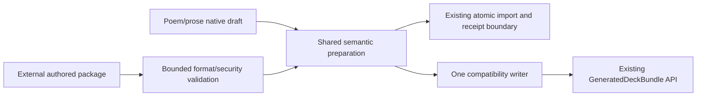

# Fresh simplification and performance investigation

Review date: November 16, 2026. This report selects **typed native poem/prose creation through the shared authored importer** for substantial simplification and **bounded ordinary study-head selection** for performance. These are proposed improvements, not implemented changes. Implementation sequencing and release remain separate work.

## Baseline, cleanup, and review method

Previous investigation reports, critiques, saved benchmark results, coverage ledgers and associated disposable evidence were removed before investigation agents started. Architecture decisions, operational documentation, release/installation receipts, Apple rejection records and recovery inputs were retained. Links and generated search/navigation references to deleted reports were repaired. The cleanup manifest records paths, not copies of historical findings. Git history was not rewritten or used as investigation evidence.

The initial commit was `5baf3fe4810512ea9e00babba2f3ae6fbfe67c3f`. Another task then removed VocabularyDeckBuilder and changed platform composition/documentation while this review was running. Those changes were preserved. A stable copy of all 866 remaining inventoried files was captured and checked against a SHA-256 manifest; findings and source-line references below use that snapshot, including the vocabulary-builder removal. The initial inventory had 870 files. Subsequent live drift is recorded separately. This investigation made no product/test implementation changes.

Three agents actually investigated the code: Core/data/builders; application/platform workflows; and sync/API/dictionary/tooling. They traced cross-boundary workflows, then independently challenged the leading alternatives. The coordinator reconciled coverage, normalized scoring, managed isolated evidence and consolidated this report. No historical investigation reports were supplied to the agents. The evidence bundle includes their detailed reports, inspection-depth ledgers, probes and challenge notes.

Every inventoried file received classification/hash coverage; first-party implementation and test sources received structural scans. Agent ledgers record 641 file-level inspections, including 165 focused/semantic inspections, with remaining files retaining their structural or metadata classification. Important workflows and candidate paths received targeted semantic inspection. This is comprehensive subsystem coverage, not a claim that every source line was independently proved correct. Generated output, upstream reference fixtures and assets are identified separately. NeoAnkiFSRS is a first-party native Swift port: its sources and integration remain in scope; the upstream numerical oracle was not independently reproved.

### Coverage and workflow ledger

| Subsystem | Cross-layer investigation and preserved boundaries |
| --- | --- |
| Models, schema, SQLite and migrations | Domain validation → stable card identity → transactions/media adoption → receipts/journal → read projections. Examine bulk/stale reconciliation, reset origins and recovery; keep durable user records authoritative. |
| Study and scheduling | Native session → eligibility/count/head/full queue → grading/repair/undo → immutable review evidence and scheduling. Native FSRS port, optimizer, dataset and promotion examined separately from operational interval variation. |
| Application and native presentation | Mac/mobile composition → capabilities/shared features → revisioned read coordination → platform navigation/browse/editing. Shared study model already exists; native controls, comparators and editor histories are deliberate differences. |
| Authoring and interchange | Poem/prose plans → generated bundle → authored compiler/import transaction → placement; JSON/CSV/portable paths and repair/migration CLIs compared. Preserve format-specific provenance, strict external validation and ordered-deck stale snapshots. |
| Media and context | Native providers → image preparation/reservations → item save; speech/recording/transcription checkpoints → recoverable context drafts. Dictionary manual field ownership differs intentionally from automatic contextual authoring. |
| Synchronization | Journal → durable outbox/assets → transport ack; inbound page+token → durable staging → validated domain transaction → visible refresh. Initial merge backup, aliases, conflict copies, relocation and lost acknowledgments are load-bearing. |
| Activity and dictionary sync | Immutable learning-time union/aliases and content-addressed resumable dictionary chunks are distinct from mutable library conflict handling. Their state machines should not be combined merely because all use CloudKit. |
| API, Chrome and CLIs | Typed registry/authentication → route dispatch → repository mutation/replay/journal → native visibility. Chrome persists exact pending body/key; dictionary CLI compiles/searches local packages rather than mutating the library through HTTP. |
| Vocabulary | Source normalization → streaming compiler/SQLite → validated pack install/catalog → indexed lookup; API/native trust and freshness checks compared. Preserve checksums, containment, schema and decoded-byte bounds. |
| Device services | Library/study changes → availability → serialized badge/reminder/widget publication. Preserve privacy-limited snapshots and keep fallible OS publication off grade/undo commit paths. |
| Supporting infrastructure | Tests/fixtures, CI, packaging/Xcode, release/deployment controllers, signing policy, documentation generation/layout/search. Static inspection only for publication/device/GUI paths; no release, installation, account or desktop operation was performed. |

The full file-level ledger identifies structural versus focused/semantic inspection. Detailed agent reports retain the longer traces and source references behind this table.

## Candidate comparison

Scores are 1–5, all higher favorable. Weighted total = 30% impact + 25% confidence + 15% implementation/verification ease + 15% low introduced complexity + 15% migration safety. Confidence concerns the evidence for the particular opportunity, not proof that an unimplemented redesign will succeed. Estimates include compatibility and meaningful verification. Weighted totals inform rather than replace correctness constraints.

### Simplification

| Candidate | Impact | Confidence | Ease | Low added complexity | Migration safety | Weighted | Indicative effort |
| --- | ---: | ---: | ---: | ---: | ---: | ---: | --- |
| Typed poem/prose creation + shared importer + canonical compatibility writer | 4 | 4 | 3 | 5 | 4 | 4.00 | 1–2 engineer-weeks |
| Shared field/attachment session | 3 | 5 | 3 | 4 | 4 | 3.80 | 4–8 engineer-days |
| One durable sync inbox handoff | 2 | 5 | 4 | 4 | 5 | 3.80 | Several days plus recovery tests |
| Typed endpoint registry owns actual API dispatch | 3 | 4 | 3 | 4 | 5 | 3.70 | About one engineer-week |
| Single native projection/invalidation session | 5 | 3 | 2 | 2 | 3 | 3.30 | 1–3 engineer-weeks |
| Explicit generated-work relation semantics | 4 | 3 | 2 | 3 | 2 | 3.00 | Several weeks; compatibility design needed |

The typed-plan winner removes an entire internal file/serialization lifecycle across both remaining builders. A field session is useful but narrower. The inbox handoff is a particularly good smaller improvement: transport already stages records, while services receive/stage them again (`CKSyncEngineTransport.swift:313–320,340–349`; `OfflineFirstSyncService.swift:179–184`; `LearningTimeSyncService.swift:30–34`). However, preserving `CloudSyncTransport.fetchPendingChanges()` behavior may require retaining its incoming payload buffer or a compatibility wrapper. Adding a refinement and skipping one restage is less structural deletion than initially assumed. Do not promise deletion of all transport buffers.

Projection ownership has broad potential: journal, command, sync, lifecycle and view callbacks all trigger reads. But `NativeLibraryReadCoordinator` already centralizes demand/cursor policy, and further consolidation must handle time-driven due changes, query generations, independent subscriptions, cancellation and held OS publishers. Adding another coordinator without retiring those owners is not simplification.

Work identity is also fragmented: persistence recognizes feature names/fields, study parses relation envelopes, and poem/prose reconcilers enforce ordering. Explicit semantics would improve architecture, but inferred legacy relations, interoperability and migration make it a larger, less certain first choice.

The winner is sensitive to priorities: if implementation ease and recovery risk dominate structural impact, the inbox handoff becomes preferable. The independent challenge explicitly distinguishes the largest bounded simplification from the lowest-risk first fix. No rule or compatibility constraint was relaxed to make the selected design score better.

### Performance

| Candidate | Impact | Confidence | Ease | Low added complexity | Migration safety | Weighted | Evidence and effort |
| --- | ---: | ---: | ---: | ---: | ---: | ---: | --- |
| Bounded ordinary study-head selection | 5 | 5 | 4 | 4 | 5 | 4.70 | Production path, SQL profiles/plans, work counters, parity and guarded query timings; several days plus eligibility tests |
| Format-preserving sync metadata batching/cache and exact inbox removal | 4 | 4 | 3 | 3 | 4 | 3.70 | Real metadata operations at 1k/10k/50k; whole-file rewrite remains; about 1–2 weeks with crash tests |
| Demand-aware mobile idle reads/device publication | 4 | 4 | 3 | 3 | 4 | 3.70 | Actual feature-model call counts; no device-energy measurement; 2–4 days focused, longer for full ownership redesign |
| Incremental study-relation maintenance after edits | 4 | 5 | 2 | 3 | 3 | 3.65 | Global dirty-trigger/rebuild traced and measured; work-group/external-write recovery makes migration harder; 1–3 weeks |
| Preaggregate FSRS promotion bootstrap losses | 3 | 3 | 4 | 4 | 5 | 3.60 | Static 2,000-draw repeated-log work; no fresh numerical performance/parity prototype; several days |
| Windowed/cached locale-correct browse results | 3 | 4 | 2 | 3 | 4 | 3.25 | Full-row reads and repeated arrangements traced; search/order parity complicates paging; 1–2 weeks |
| Requested-pack API dictionary validation/catalog | 3 | 3 | 3 | 3 | 4 | 3.15 | Static full installed-tree fingerprint on lookup; validation freshness must survive; about one week |

Performance ranking uses measured work and production call paths, not source size alone. The selected opportunity has reproducible query plans, statement work counters, result-parity probes and CPU sampling. Competing mechanisms were investigated; measured versus static-only evidence is distinguished below. No product implementation was changed to obtain a headline speedup.

## Simplification recommendation: remove the native authored-file round trip

### Evidence and current flow

Poem (`Sources/PoemDeckBuilder/PoemDeckGenerator.swift:77–109,147–216,259–333`) and prose (`Sources/ProseDeckBuilder/ProseDeckGenerator.swift:43–76,88–166,193–266`) build native content, project it into private wire records, create a temporary workspace, write manifest/JSONL, validate the authored package, and return a cleanup-bearing URL. Native creation then calls the authored loader/importer again (`Sources/NeoAnkiApplication/LibraryRepository.swift:967–975`; `NeoAnkiCore/Sources/NeoAnkiCore/AuthoredDeck/AuthoredDeck.swift:62–155`).

There are **20 private DTO declarations representing 10 shared wire-shape kinds across two generators**, not 20 independent policies. The duplicated responsibilities are wire projection/encoding, temporary package layout/lifetime, format validation/reparse, and native import/placement orchestration. Domain poem/prose parsing, prompt construction and existing editor reconciliation remain distinct.

The existing authored compiler already produces a typed package (`AuthoredDeck.swift:209–217`); the importer already owns schema-digest reuse, ordinal field remapping, new identities and ordered creation (`AuthoredDeck/ItemStore+AuthoredDeck.swift:14–105`). The redesign should reuse that semantic boundary rather than invent a privileged sequence of create calls.

### Proposed design and interfaces

- Introduce a small typed native draft and validated creation plan at the Core/application boundary. These names describe responsibilities, not a finalized public API. Share semantic preparation and the existing atomic authored importer; ordinary native creation performs no temporary authored-package round trip.
- Keep one canonical authored writer for explicit export and existing bundle/workspace/registry callers. Preserve the public `GeneratedDeckBundle`, workspace provider and `AnyDeckBuilderFeature` signatures and observable compatibility behavior; add a typed capability/facade without forcing legacy callers to migrate together.
- Retain bounded external authored parsing, symbolic reference checks, security/path/media validation and existing format/schema and compatibility behavior. Keep portable/JSON/CSV adapters and their intentional provenance/type-compatibility rules. Unifying every transfer format is not required for this recommendation.
- Preserve all currently applicable content/count/size rejection safeguards. Map every current `AuthoredDeckLimits` rejection: if preserving an encoded-byte budget requires running the shared writer into a counting sink, retain that bounded encoding without temporary files or reparsing. Do not promise zero serialization or byte-for-byte JSON key order. Typed input does not authorize bypassing validation, type policy, generated-card limits, media ownership or stale-definition checks.
- Keep existing poem/prose editor bulk reconciliation and Item Type Studio authorization. They already use typed operations; replacing them is unnecessary. Studio's captured original/candidate/impact authorization and rebasing logic remain intact (`ItemTypesFeatureModel.swift:292–379`).

### Required behavior corrections

| Divergence | Required behavior |
| --- | --- |
| Native import creates the deck, then applies parent in another write: Mac `ContentView.swift:901–918`; iOS `ManagementViews.swift:315–333,369–386` | Validate chosen parent and commit creation/placement in one transaction. Parent disappearance rejects creation without leaving an unexpected top-level deck. |
| Mac reports placement partial success, while mobile can report generic failure after creation committed | Preserve committed success/receipt; present subsequent refresh/cleanup warnings separately. Retrying a read must not recreate a deck. |
| Existing destination-deck import can mean importing contents into an existing deck | Distinguish this from creating a new root under a parent. Do not reuse the parameter in a way that suppresses the generated hierarchy. |

These are deliberate correctness changes, not claims of identical current behavior. They require focused acceptance tests and separate implementation review.

### Alternatives and acceptance

Sharing only DTOs would remove some declarations while retaining files, cleanup and repeated parse. Returning an already parsed package would reduce reparsing but retain the interchange boundary. A new generic builder/plugin framework would introduce complexity without removing domain rules. The selected design uses a validated constructor into an existing semantic importer and one compatibility writer.

Acceptance requires the normal poem/prose creation paths to use the typed plan, retirement of their independent wire/lifecycle implementations, and a before/after responsibility/removal inventory. A wrapper with both old pipelines still active does not qualify.

Compare typed creation with compatibility-bundle import in independent temporary libraries: exact prompt/answer/attribution, stanza/paragraph separators, card/template counts, schema reuse and field mapping, first-study and browse order, destination policies, journal/receipt semantics and reopen/export/import. Preserve card identities, histories and schedules during existing editor reconciliation. Exercise deleted parent, stale draft/type authorization, validation/commit failure, cancellation, postcommit refresh failure and same-operation recovery. External authored/portable security and round-trip suites must continue to pass.

## Performance recommendation: bounded ordinary study-head selection

### Causal evidence

The real shared study model requests one card before publishing its first ready state, then loads the full queue (`Sources/NeoAnkiFeatures/StudyFeatureModel.swift:223–227,264–280`). Its repository/store path reaches `SQLiteDatabase.swift:5052–5149`. The bounded request currently includes two library-sized SQL operations:

1. A `hasWork` preflight joins from cards and probes relations to establish that there are no ordered works (`:5060–5066`).
2. The ordinary new-card partition uses a general eligibility query whose observed plan scans candidates through the phase index and sorts before applying its one-row limit (`:5082–5100`).

The existing active-new/due index can support an ordered specialized query. The work relation index can make an empty work check constant-sized. An unconstrained SQL rewrite is insufficient: an early relation-first variant still scanned work state; the final probe explicitly selects the appropriate existing index. Those variants have separate evidence and must not share timing/work claims.

The host was Mac15,7, 12 CPU cores, 36 GiB RAM, macOS 27.2.1, Swift 6.4.2 and SQLite 3.54.0. Swift links the system SQLite library used by the statement counters; Python SQL probes reported the same SQLite version. Fixtures and compilation were outside the timed statement regions. The source and retained SQLite fixture manifests record exact hashes; metadata inputs use the recorded baseline/payload generator. Generated UUIDs are retained within a run, not assumed identical across fresh fixture construction.

The initial public-production-path sweep used 100/1,000/25,000/100,000 independent Basic items. It included warm reads, individual tag edits, full queue hydration and browse/search. Unrelated Xcode builds overlapped that sweep: its elapsed values are retained as **exploratory**, not used as accepted speedup or tail-latency estimates. CPU samples confirm SQLite stepping/page work but optimized inline line numbers do not reliably distinguish every query partition.

A subsequent guarded SQL campaign retained one excluded warm-up, 100 observations for short statements and five for expensive statements. No Xcode build was detected at the beginning or end of those flows. Host background activity was not disabled; boundary guards cannot prove the machine was completely idle. These are warm-cache, reconstructed production-predicate/order statements selecting card IDs, not a modified app or full Card hydration.

| Ordinary new-head statement | Current median | Ordered-index prototype median | Current retained samples | Prototype retained samples |
| --- | ---: | ---: | ---: | ---: |
| 100 cards | 0.219 ms | 0.0089 ms | 100 | 100 |
| 1,000 cards | 2.835 ms | 0.0117 ms | 100 | 100 |
| 25,000 cards | 131.951 ms | 0.0128 ms | 5 | 100 |
| 100,000 cards | 955.770 ms | 0.0167 ms | 5 | 100 |

At 100,000 cards, the existing new statement ranged 941.559–989.505 ms; the prototype ranged 0.0129–0.0264 ms. Its 100-sample p95 was 0.0184 ms. No p95 is asserted for the five-sample existing large query, and no end-to-end application multiplier is claimed.

Deterministic SQLite statement counters provide the stronger scaling evidence:

| 100,000 ordinary cards | Current work | Proposed-path probe work |
| --- | ---: | ---: |
| Full production new-head SELECT projection | 12,700,267 VM instructions; one sort | 145 VM instructions; no sort |
| Work preflight when there are globally no ordered-work relations | 1,100,015 VM instructions | 10 instructions for indexed global-negative gate; no sort |

The full-projection counter probe separately repeats the actual production column projection; its counters are not combined with the ID-only query wall times above. The corresponding ID-only counters were 12,700,064 → 132 instructions. The new-head statement chooses the phase index plus temporary ORDER BY B-tree today; the prototype uses the existing active-new/due index. The proposed negative gate performs a covering work-index search. An earlier forced relation-first semijoin used 18 instructions on empty-work fixtures, but may be worse for dense future/suspended works; it is retained as a prototype, not selected as an unconditional replacement. The chosen design keeps the existing scoped/due work query whenever any ordered-work relation exists globally. The negative gate was not wall-timed during baseline tests.

A separate 100,000-card mixed fixture (25,000 each new/review/future/suspended) returned the same IDs: new-head work fell from 3,500,063 to 132 instructions, with its sort removed. Twenty-one new-head result comparisons cover scope/unassigned, families, a due learned relative, suspension/future cards and missing usable templates. Twenty-one separate work-existence comparisons and eighteen conservative-gate comparisons passed. These probes do not establish daily-limit, all-work or revert equivalence; those routes stay unchanged and retain their production contract tests.

The corrected history fixture submitted 12,000 real reviews across 1,000 cards, preserved all records after tag/type-name edits, and tested due learned cards at a later clock. Repeated combined mature head/scope reads were about 0.83–1.12 ms after a 292 ms cold read. First reads after tag/type-name invalidation were about 22/326 ms before returning to sub-millisecond/roughly one-millisecond reads. These are diagnostic cold/invalidated versus warm observations, not five retained cold samples. Mature heads are already efficient; history/projection invalidation is a distinct opportunity. An initial invalid rename probe accidentally supplied a fresh template identity; it was corrected to use the stored type, and both logs are retained without treating the fixture mistake as a product defect.

### Measured competitors

**Sync metadata:** exact production metadata/fetcher source copies call receive/consume/ack/save against temporary files, with restart persistence checks. One excluded warm-up and five retained repetitions at each final scale produced:

| Synthetic baseline | One-record page + consume | Unchanged bookkeeping | Outbound acknowledgment |
| --- | ---: | ---: | ---: |
| 10,000 records | 291.75 ms | 152.35 ms | 106.98 ms |
| 50,000 records, about 30.9 MB | 1,741.50 ms | 860.20 ms | 633.22 ms |

This is substantial measured write amplification, not a negligible background cost. The property list contains full baseline envelopes and is decoded/rewritten for small updates. A decoded-state cache removes redundant reads but cannot eliminate whole-file encoding; batching must preserve page/token, ack/baseline and domain-commit boundaries. A SQLite metadata redesign would change a persisted format and is not the default under the compatibility constraint. No optimized durability-equivalent metadata implementation was measured. The selected study opportunity has a more bounded migration and direct default foreground trigger, rather than simply the largest isolated duration.

**Application refresh:** an external counter wraps the real SQLite adapter and calls the production feature model. With twelve decks, three idle refreshes after opening browse performed three home reads, three catalog reads, three all-scope item reads, 36 availability reads, six cursor reads and three widget publications. The notification stream deliberately finishes to isolate explicit refresh work: these are reproducible lower-bound counts, not the complete native view/journal race or device-energy measurements. This supports demand-aware refresh as a credible competitor; it does not prove every callback should merge into one state machine.

**Post-edit relation maintenance:** triggers globally dirty the derived relation/template projection on item/type changes; the next read rebuilds it. The public-path sweep and corrected history experiment exercise that invalidation. Its optimization must account for old/new work groups, external connections, restart and journal gaps, which makes it a larger recovery design than the selected indexed head path.

### Proposed design and preserved semantics

Use a dedicated ordered-index cursor for the ordinary no-limiter new-head path, retaining all existing usability and family predicates and deterministic due/ID ordering. Before the work preflight, use the existing work index to test whether any ordered-work relation exists globally. If none exists, safely skip the card join; otherwise retain the original scoped/due work query and ordering. Keep the gate and subsequent selection/fallback inside the same consistent read snapshot after derived-relation refresh, including protection against other SQLite connections. Preserve the current limit-constrained and ordered-work routes until separately proved equivalent. The normal deck default is unlimited (`Models/Deck.swift:18`); a settings field initially showing 20 does not mean the throttle is enabled.

No new persistent cache, schema, endpoint, DTO or file-format change is needed. Existing methods and responses remain intact. The result must equal the head of the complete ordered eligible queue; raw due cards are not an equivalent substitute. Suspended/future cards, family representatives, learned relatives, work order, daily/ancestor limits and missing/corrupt templates all matter.

This recommendation does not claim faster grading from SQL alone. First-card publication also waits for earlier count/type work, and grading remains disabled until the full queue is ready. Full queue hydration and the post-edit relation rebuild remain separate candidates. No whole-workflow speedup multiplier is inferred from statement-only probes.

### Alternatives and acceptance

A forced index on the entire general CTE may help one plan while retaining unnecessary global eligibility work or regressing constrained cases. Full queue paging/session redesign has higher potential but must preserve global work/family order, repair, undo and corruption validation. Persistent eligibility materialization adds invalidation and migration responsibilities. Prefer bounded specialized reads plus conservative fallbacks first.

Acceptance requires:

- Exact first-card/full-queue-head equality for ordinary and family-linked items, new/review/repair phases, suspended/future cards, scope/unassigned/descendants, same-due ties, work-containing libraries, limits/rollover and reverted introductions.
- Hold/mutate through the gate boundary using a second connection and verify one consistent snapshot, including work insertion/move/type changes and projection invalidation.
- Existing family and learned-card index guarantees retained; ordinary no-work preflight must scale with work relations, and the default new head must avoid a temporary sort. On the independent-card fixture it must avoid scanning unrelated candidates; arbitrary family/usability predicates and sparse scopes can still require examining rejected earlier index entries.
- At least 90% fewer statement VM instructions on the 100,000-independent-card fixture, with scoped/mixed parity. Reuse existing indexes and formats.
- An implementation benchmark on the recorded host targeting warm one-card fetch median at most 100 ms and p95 at most 200 ms at 100,000 ordinary cards, measured with sufficient samples and no competing builds. Treat these as opt-in acceptance measurements, not timing-only CI assertions. Rebaseline explicitly for other hardware.
- Separately measure first-visible-card and ready-to-grade milestones and check competing mixed/work/limited cases for material regressions. Explain any regression above 10% in matched uncontended measurements before acceptance.

## Other findings and investigation limits

The generic optional API replay path executes a mutation before claiming/completing its key (`NeoAnkiAPIService.swift:741–758`), while item-type duplication uses that path. `withAPIMutation` is a mutex, not one cross-call database transaction. A failure between domain commit and key persistence can leave an unrecorded committed resource; completed generic replay also reconstructs fewer headers than some original responses. This is a source-supported recovery gap and an **unexecuted failure scenario**, not a reproduced incident. A separate implementation should inject that boundary and verify one identity, original replay headers and stable same-key results. Claiming a key before execution alone would not solve recovery. This finding is not folded into the two recommendations.

The investigation used headless code, temporary synthetic libraries and probes. It did not use production learner data, Apple accounts, live CloudKit, physical devices, installed applications or desktop interaction. Native layout/frame rate, device energy, real notification delivery, signed platform acceptance and Apple server behavior are not established. Static call-count and sequential-buffer estimates are not measured simultaneous allocations or energy savings.

Focused baseline verification ran against the pinned snapshot with isolated build/TMP directories: **78 Core tests and 83 root-package tests passed (161 total), with no test failures or reruns**. Selection covered eligibility/index plans, families/limits/order/scopes, hydration/reservations, authored security/schema/reconciliation, poem/prose generation and native/shared feature contracts. Exact filters, commands, actual runner summaries and one-shot receipts are in `application/verification/` and `application/verification-results.md` in the archive.

The existing live documentation validator passed for 53 features after cleanup, and the final report/link changes received a separate final documentation check recorded in the evidence. Snapshot hash verification checked all 866 files. Product code was not modified by this investigation, and unrelated concurrent work was preserved. The full fast suite, live browser integration, native builds, UI journeys and publication/device checks were not run as investigation gates; relevant supporting suites were inspected structurally or by focused contracts. This baseline does not test an unimplemented redesign.

Original probe build failures and the invalid preliminary history experiment remain in the evidence with their corrections. They were external diagnostic harness issues; no application assertion was weakened, skipped or retried to obtain a green result. Early contaminated timings and later guarded results are separate artifacts.

The report and evidence support a separate implementation and release plan. Neither proposed improvement has been implemented or released.

[Coverage ledger]({{ '/audits/comprehensive-codebase-review-2026-11-16-coverage.tsv' | relative_url }}) and [reproducibility evidence]({{ '/audits/comprehensive-codebase-review-2026-11-16-evidence.tar.gz' | relative_url }}) contain the full subsystem reports, independent challenges, source hashes, raw measurements/profiles, diagnostic sources, commands, cleanup manifest and validation logs. Large synthetic databases and disposable build outputs are excluded from the archive and remain local for reproduction.
