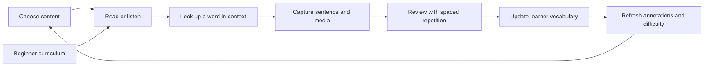

# Migaku replacement requirements for NeoAnki2



**Assessment date: November 12, 2026. Research conducted November 11–12.** NeoAnki2 already provides much of the storage, authoring, review, and Apple-device sync foundation needed for a Migaku replacement. The largest missing product is an integrated immersion environment: understand words in their original context, capture that context as a useful card, and use learning history to improve subsequent reading and listening.

Adding more flashcard interactions would make relatively little progress toward replacement. The highest-value work is a language analysis and learner-vocabulary layer, followed by contextual lookup and sentence mining across webpages, subtitles, books, and mobile capture. Beginner curricula, dictionary distribution, migration, and platform availability are separate substantial requirements.

“Any language” requires two commitments: a system that permits new language capabilities without changing the general study engine, and validated resources for every language advertised as ready. No finite dictionary catalog or generic AI prompt establishes universal language coverage. Migaku itself advertises a bounded set of languages.

## Scope and evidence

This is an inventory of publicly documented functionality, compared with the **current local working tree**, including its uncommitted Chrome companion. The repository base is `a097a74b6ab7f0fd5b135e8e64cc1c3caa987941`; working-tree additions are not evidence of shipped Store functionality.

The research includes official FAQs, 18 written descriptions accompanying official video guides, the public changelog, current Apple and Google store listings, a grammar-reference example, and 19 official product/store images. The public grammar lesson and pricing page were also rendered and inspected in an isolated headless browser. Guide descriptions were read; full videos were not watched. Paid account screens and production streaming integrations were not exercised. The app comparison uses documentation and implementation inspection, not a fresh GUI acceptance run.

Evidence strength:

- **Release evidence:** dated release notes establish when a feature was reported shipped on that platform/channel. They do not establish that every integration still works today.
- **Documented:** official instructions or listings describe the behavior. Older instructions can be superseded by newer release notes.
- **Visual:** an official screenshot demonstrates a layout or information relationship, not reliability or current availability.
- **Proposed:** the implementation requirements and priorities below are our assessment, not claims about Migaku internals.

The [source and image manifest](migaku-2026-11-11-evidence.json) records source URLs, retrieval date, content hashes, image dimensions, and observations. Public material spans several product generations; this matters enough to resolve explicitly.

## Corrections to a superficial comparison

| Topic | Evidence and consequence |
| --- | --- |
| Reader | The FAQ still describes ebooks as forthcoming. Standard Reader releases appear in May 2026. It belongs in the replacement scope. [FAQ](https://migaku.com/faq/getting-started), [changelog](https://migaku.com/blog/changelog) |
| Recent mobile changes | The current iOS listing shows 2.71.0. Its version history adds study weekdays and pauses, independent tracking, vertical reading, and a story catalog. The public changelog stops at August 18; it is not the latest mobile specification. [iOS version history](https://apps.apple.com/us/app/migaku-really-learn-languages/id1664096855) |
| Current extension | The fetched Chrome listing reports 1.32.0, updated November 6, 2026. Its copy still lists ten languages and five video sites, so marketing copy alone is insufficient for coverage. [Chrome listing](https://chromewebstore.google.com/detail/migaku-languages/lkhiljgmbeecmljiogckofcalncmfnfo) |
| Learning status | Older guides describe five states. Newer iOS notes separate tracking from knowledge status. Model these as independent properties; do not copy a legacy enum blindly. [Older guide](https://migaku.com/blog/youtube/the-learning-statuses-migaku-browser-extension), [iOS history](https://apps.apple.com/us/app/migaku-really-learn-languages/id1664096855) |
| Languages and courses | Current official pages name Japanese, Mandarin, Cantonese, Korean, English, Spanish, French, German, Portuguese, Italian, and Vietnamese. Course availability varies; English course claims differ between listing sections. Do not promise a complete course for every supported language. [Getting started](https://migaku.com/faq/getting-started), [Chrome listing](https://chromewebstore.google.com/detail/migaku-languages/lkhiljgmbeecmljiogckofcalncmfnfo) |
| Streaming coverage | The FAQ names YouTube, Netflix, Disney+, Rakuten Viki, and Animelon on desktop; mobile YouTube. April 2026 notes add Bilibili and iQIYI. Maintain a platform-specific integration matrix. [FAQ](https://migaku.com/faq/getting-started), [changelog](https://migaku.com/blog/changelog) |
| Pronunciation coaching | Migaku describes shadowing and explicitly says it lacks a dedicated pronunciation-practice tool. Automated speech scoring and conversation tutoring are not established parity requirements. [Goals FAQ](https://migaku.com/faq/goals) |

The 21-day “known” rule in an older guide is a historical explanation, not an appropriate invariant for NeoAnki2. The current public material also does not establish Migaku's scheduling algorithm precisely enough to claim an FSRS performance comparison. [Tracking guide](https://migaku.com/blog/youtube/supercharge-your-language-learning-tracking-learned-words)

## The product loop that must be replaced

Migaku links content consumption and memory practice: the learner looks up words while reading or watching, makes cards with the surrounding media, reviews them, and receives content difficulty information based on learned vocabulary. Its structured courses supply an entry point for beginners. [Feature overview](https://migaku.com/faq/features)

NeoAnki2's strongest coverage is D's storage foundation and E. Its Add Word flow also covers dictionary-to-item authoring. The connection from a running piece of content to a lexical entry, the persistent learner-vocabulary model, and the return path to content are largely absent.

## Functionality matrix

**Present** means an existing usable capability. **Partial** means supporting data or a narrower workflow exists. **Missing** means no corresponding user workflow was found in the inspected source and docs. **Decision** means parity conflicts with current scope or requires an explicit platform/content commitment. These are not numerical parity scores.

The NeoAnki2 evidence codes refer to the local source map following the matrix. Each row's external link supports its Migaku behavior; the NeoAnki2 assessment and required work are local findings or proposals.

### Reading and contextual lookup

| ID | Migaku behavior | NeoAnki2 status | Required work |
| --- | --- | --- | --- |
| R01 | Click or modifier-hover lookup in enabled webpages. [Popup guide](https://migaku.com/blog/youtube/the-popup-dictionary-migaku-browser-extension) | **Partial**, N1: toolbar popup reads a selection. | Lookup beside the source text without moving through a separate authoring window. |
| R02 | Remember site enablement and parse text on the page. [Popup guide](https://migaku.com/blog/youtube/the-popup-dictionary-migaku-browser-extension) | **Missing**, N1. | Opt-in site adapters, dynamic-content handling, sentence boundaries, and reversible annotations. |
| R03 | Several dictionaries and supplementary lexical assets in one lookup. [Dictionary guide](https://migaku.com/blog/youtube/the-dictionary-migaku-browser-extension) | **Partial**, N2–N4: packs, senses, forms, and pronunciation exist; ordinary lookup selects one pack. | Merge and rank results while preserving dictionary order and provenance. |
| R04 | Bilingual/monolingual resources and user dictionary uploads. [Feature overview](https://migaku.com/faq/features) | **Partial**, N2: imports compiled `.neovocab` packages. | A discoverable catalog, ready-to-install resources, and practical import adapters. |
| R05 | Dictionary activation and frequency-list selection. [Settings guide](https://migaku.com/blog/youtube/the-settings-migaku-browser-extension) | **Partial**, N2: one numeric frequency value and pack capabilities. | Multiple named frequency sources, priorities, genre information, and useful ranks in lookup. |
| R06 | Contextual explanation, sentence translation, and grammatical breakdown. [Feature overview](https://migaku.com/faq/features) | **Missing**, N1–N4. | A source-aware explanation service with user-editable output. |
| R07 | Native word audio and images during lookup. [Dictionary guide](https://migaku.com/blog/youtube/the-dictionary-migaku-browser-extension) | **Partial**, N2–N4: local pronunciation audio and manual image attachments. | Integrated licensed audio/image choices; do not confuse media playback with media acquisition. |
| R08 | Clipboard text becomes an interactive reading surface. [Clipboard guide](https://migaku.com/blog/youtube/the-clipboard-migaku-browser-extension) | **Missing**, N8: prose generation is a different task. | Paste/read/lookup/mine without first constructing a deck. |
| R09 | Optional clipboard monitoring supports external OCR and text hooks. [Clipboard guide](https://migaku.com/blog/youtube/the-clipboard-migaku-browser-extension) | **Missing**, N1/N8. | Explicitly enabled ingestion with stable context and duplicate handling. |
| R10 | Mobile photo/screenshot OCR feeds interactive lookup. [Goals FAQ](https://migaku.com/faq/goals) | **Partial**, N4: image intake exists; OCR does not. | Text recognition, editable reading order, token hit regions, then ordinary capture. |
| R11 | Imported Reader: EPUB/HTML/TXT/RTF; SRT/VTT/ASS/SSA text; TTS read-along and comprehension library. [Changelog](https://migaku.com/blog/changelog) | **Missing**, N8. | A content library and reader independent of the card database. |
| R12 | Vertical text in Japanese/Chinese/Cantonese reading. [iOS history](https://apps.apple.com/us/app/migaku-really-learn-languages/id1664096855) | **Missing**, N4/N8. | Writing-direction-aware reader, annotation, and selection. |
| R13 | Public grammar lessons with language/topic filters. [Grammar reference](https://migaku.com/grammar) | **Missing**, N8. | A reference-content system connected to examples and study items. |
| R14 | Standalone dictionary search. [Dictionary guide](https://migaku.com/blog/youtube/the-dictionary-migaku-browser-extension) | **Partial**, N2/N3: lookup is primarily part of authoring. | A useful reference mode that does not require adding a card. |
| R15 | Plaintext and recursive popups. [Changelog](https://migaku.com/blog/changelog) | **Missing**, N1. | Lookup without annotating a whole page, plus lookup inside definitions with predictable back navigation. |
| R16 | Inline word translations, documented in EA. [Changelog](https://migaku.com/blog/changelog) | **Missing**. | Optional translations attached to original spans; verify current channel entitlement before treating it as standard parity. |
| R17 | Custom AI prompts and inflection views. [Changelog](https://migaku.com/blog/changelog) | **Partial**, N2: inflected forms are stored. | Editable explanation preferences and navigable form/grammar information. |

### Listening and video

| ID | Migaku behavior | NeoAnki2 status | Required work |
| --- | --- | --- | --- |
| V01 | Interactive streaming subtitles on desktop and mobile. [Getting started](https://migaku.com/faq/getting-started) | **Missing**, N1: manually selected transcript text only. | Live timed-text ingestion and dictionary interaction; start with YouTube. |
| V02 | Target and secondary subtitles, sizing, and visibility options. [Video toolbar](https://migaku.com/blog/youtube/the-toolbar-on-video-sites-migaku-browser-extension) | **Missing**, N1/N4. | An aligned two-track subtitle model and accessible display controls. |
| V03 | Playback pauses or reveals subtitles according to learning needs. [Video toolbar](https://migaku.com/blog/youtube/the-toolbar-on-video-sites-migaku-browser-extension) | **Missing**. | Playback policies tied to lexical annotations. |
| V04 | Primed listening previews text before playing dialogue. [Courses FAQ](https://migaku.com/faq/courses) | **Missing**. | A deterministic sentence playback state machine. |
| V05 | Skip or accelerate sections without dialogue. [Video toolbar](https://migaku.com/blog/youtube/the-toolbar-on-video-sites-migaku-browser-extension) | **Missing**. | Gap-aware navigation with adjustable margins. |
| V06 | Jump/replay/hide/copy subtitle shortcuts and transcript browser. [Video controls](https://migaku.com/blog/youtube/video-controls-migaku-browser-extension) | **Missing**. | Keyboard and touch equivalents operating on the same cue IDs. |
| V07 | Filter/bookmark subtitle candidates. [Chrome listing](https://chromewebstore.google.com/detail/migaku-languages/lkhiljgmbeecmljiogckofcalncmfnfo) | **Missing**. | A mining queue that retains source position and target word. |
| V08 | Local video playback as a mining environment. [Feature overview](https://migaku.com/faq/features) | **Partial**, N4: cards play attached videos. | Long-form player, external subtitle tracks, and clip extraction. |
| V09 | User-supplied subtitles and playlists. [Homepage](https://migaku.com/), [changelog](https://migaku.com/blog/changelog) | **Missing**. | Subtitle import/offsets, file pairing, queue and resume state. |
| V10 | Generate subtitles when source captions are unavailable. [Getting started](https://migaku.com/faq/getting-started) | **Missing**. | Speech recognition with timing, language choice, correction, and resumable jobs. |
| V11 | Podcasts: discovery, transcription, and audio mining. [Changelog](https://migaku.com/blog/changelog) | **Missing**. | Feed/episode ingestion and the shared timed-audio pipeline. |
| V12 | Combine selected subtitle lines for card creation. [iOS history](https://apps.apple.com/us/app/migaku-really-learn-languages/id1664096855) | **Missing**. | Editable sentence boundaries and clip start/end controls. |
| V13 | Bulk mining and card queue. [Changelog](https://migaku.com/blog/changelog) | **Partial**, N7/N9: bulk item/import facilities. | A candidate queue with per-card preview, ordering, progress and recoverable extraction failures. |
| V14 | Secondary-subtitle generation. [Changelog](https://migaku.com/blog/changelog) | **Missing**. | Translate aligned cues, preserve timing, and permit correction without overwriting the source transcript. |
| V15 | Multiple audio tracks and MKV playback. [Changelog](https://migaku.com/blog/changelog) | **Partial**, N4: supported card video formats exclude MKV. | A long-form playback/import policy, codec capability checks and reliable clip conversion. |

### Card creation and reviewing

| ID | Migaku behavior | NeoAnki2 status | Required work |
| --- | --- | --- | --- |
| C01 | One action captures sentence, screenshot, and source audio from video. [Video card guide](https://migaku.com/blog/youtube/card-creation-from-video-content-migaku-browser-extension) | **Partial**, N1/N4: source URL/title plus selected text; manual media authoring. | A capture transaction that assembles and previews all assets. |
| C02 | Fast automatic creation or an editable intermediate draft. [Video card guide](https://migaku.com/blog/youtube/card-creation-from-video-content-migaku-browser-extension) | **Partial**, N1/N3: drafts and editable autofill exist. | Share capture configuration across desktop/mobile and preserve manual choices. |
| C03 | Word, audio-word, sentence, and audio-sentence card presets. [Card Creator guide](https://migaku.com/blog/youtube/the-card-creator-migaku-browser-extension) | **Partial**, N3–N5: customizable types can express these. | Ready-made native presets and automatic field mapping; audio still needs a source. |
| C04 | Text-origin cards collect definitions and supplementary media. [Text card guide](https://migaku.com/blog/youtube/card-creation-from-text-content-migaku-browser-extension) | **Partial**, N2/N3. | Capture the original sentence and chosen sense, rather than only the selected word. |
| C05 | TTS enriches generated study materials. [Feature overview](https://migaku.com/faq/features) | **Missing**, N4/N5: no reference voice synthesis. | Selectable word/sentence voices and persistent reusable audio. |
| C06 | Translate/explain into a selected output language. [Card Creator guide](https://migaku.com/blog/youtube/the-card-creator-migaku-browser-extension) | **Partial**, N2: definition language metadata, no generation. | Independent target, interface, and explanation-language settings. |
| C07 | Send mined cards to Migaku Memory or Anki. [Card Creator guide](https://migaku.com/blog/youtube/the-card-creator-migaku-browser-extension) | **Decision**, N7: no Anki bridge. | Direct NeoAnki2 capture is essential; Anki export is an interoperability choice. |
| C08 | Scheduled offline card review with synchronized media. [Google Play listing](https://play.google.com/store/apps/details?id=com.migaku.android&hl=en_US) | **Present**, N5/N6, within Apple platforms and provisioned sync builds. | Reuse the existing scheduler and offline library. |
| C09 | Import Anki language decks into four supported card types. [Google Play listing](https://play.google.com/store/apps/details?id=com.migaku.android&hl=en_US) | **Decision**, N7: `.apkg` is an explicit non-goal. | A constrained external converter or a documented scope change. |
| C10 | Per-language card organization and switching. [Google Play listing](https://play.google.com/store/apps/details?id=com.migaku.android&hl=en_US) | **Partial**, N2/N5: language metadata and decks, no learner-language workspace. | Language profiles connecting resources, captured content, and learning state. |
| C11 | Weekday schedules, study pauses, and activity heatmap. [iOS history](https://apps.apple.com/us/app/migaku-really-learn-languages/id1664096855) | **Partial**, N5/N6: daily limits, due counts, reminders; no equivalent calendar policy. | Define pause/resume effects without silently rewriting FSRS history. |
| C12 | Rich review cards with independent word/sentence audio and contextual media. [Official review images](https://migaku.com/assets/srs2.webp) | **Present foundation**, N4/N5. | Package a useful default composition; retain advanced custom layouts. |
| C13 | Study-more and review-shuffle options. [Changelog](https://migaku.com/blog/changelog) | **Partial**, N5: deterministic due-first queues and daily new-card limits. | Decide whether optional extra-new-card sessions and alternate queue ordering fit the study policy. |

### Vocabulary knowledge and guidance

| ID | Migaku behavior | NeoAnki2 status | Required work |
| --- | --- | --- | --- |
| K01 | Remember lexical knowledge beyond individual cards. [Status guide](https://migaku.com/blog/youtube/the-learning-statuses-migaku-browser-extension) | **Missing**, N2/N5: dictionary entries and card maturity are separate. | Persistent lexical identities, knowledge state, manual overrides, and review-derived evidence. |
| K02 | Track/ignore words and mark prior knowledge. [Status guide](https://migaku.com/blog/youtube/the-learning-statuses-migaku-browser-extension) | **Missing**. | Orthogonal interest/ignore flags; preserve changes when cards are deleted. |
| K03 | Word management and bulk known-word entry. [Changelog](https://migaku.com/blog/changelog) | **Partial**, N5/N9: item browser and item APIs are not a vocabulary browser. | Search/filter lexical state, import prior knowledge, and distinguish senses/forms. |
| K04 | Content comprehension and recommended-sentence indicators. [Text toolbar](https://migaku.com/blog/youtube/the-toolbar-on-text-sites-migaku-browser-extension) | **Missing**. | Explainable token coverage, unknown vocabulary, and candidate ranking. |
| K05 | Identify sentences with a manageable learning increment. [Feature overview](https://migaku.com/faq/features) | **Missing**. | Rank candidate sentences against learner vocabulary and source frequency. |
| K06 | Known-word totals surfaced during content consumption. [Text toolbar](https://migaku.com/blog/youtube/the-toolbar-on-text-sites-migaku-browser-extension) | **Partial**, N5: card/deck maturity and due counts only. | Count lexical units under an explicit identity policy. |
| K07 | Dashboard entry points and content recommendations. [Dashboard guide](https://migaku.com/blog/youtube/the-dashboard-migaku-browser-extension) | **Missing**, N8. | Content home, continue actions, and curated sources. |
| K08 | Initial vocabulary assessments. [Changelog](https://migaku.com/blog/changelog) | **Missing**. | Optional language-specific assessment with inspectable imported knowledge. |
| K09 | AI short-story generator appears in EA notes. [Changelog](https://migaku.com/blog/changelog) | **Missing**. | Optional later feature; standard availability and vocabulary-control accuracy remain unresolved. |

### Language support and curriculum

| ID | Migaku behavior | NeoAnki2 status | Required work |
| --- | --- | --- | --- |
| L01 | Japanese readings with visibility rules and pitch coloring. [Japanese guide](https://migaku.com/blog/youtube/japanese-specific-features-migaku-browser-extension) | **Partial**, N2/N4: arbitrary pronunciation text, no ruby or pitch semantics. | Token-linked readings, structured pitch data, and accessible annotations. |
| L02 | Mandarin Pinyin/Zhuyin, tone coloring, simplified/traditional display. [Mandarin guide](https://migaku.com/blog/youtube/mandarin-specific-features-migaku-browser-extension) | **Partial**, N2: representation schemes can store text. | Syllable alignment, tones, display conversion, and preserved source spelling. |
| L03 | Cantonese Jyutping. [Changelog](https://migaku.com/blog/changelog) | **Partial**, N2. | A distinct Cantonese resource/profile capability, independent of Mandarin. |
| L04 | German and French noun-gender display rules. [German guide](https://migaku.com/blog/youtube/german-specific-features-migaku-browser-extension), [French guide](https://migaku.com/blog/youtube/french-specific-features-migaku-browser-extension) | **Partial**, N2: grammatical traits can carry gender. | Render selected traits in context and expose equivalent textual labels. |
| L05 | Fundamentals teaches writing, sounds, and pronunciation rules. [Courses FAQ](https://migaku.com/faq/courses) | **Missing**, N8: no shipped language curriculum. | Authored lessons, examples, recordings, and a guided progression. |
| L06 | Academy links grammar lessons with incrementally introduced sentence cards. [Courses FAQ](https://migaku.com/faq/courses) | **Partial infrastructure**, N5/N7: native schemas and learning routes. | A course sequencing layer plus edited content. |
| L07 | Kanji/component learning, mnemonic stories, and character reference. [Courses FAQ](https://migaku.com/faq/courses) | **Missing**. | A data-driven character reference and curriculum; Hanzi remains described as forthcoming in that FAQ. |
| L08 | Domain vocabulary decks arranged by frequency. [Courses FAQ](https://migaku.com/faq/courses) | **Partial**, N2/N7: generic deck creation. | Curated topic packs, useful defaults, and resource distribution. |
| L09 | Grammar reference with readable lessons and contextual examples. [Grammar lesson](https://migaku.com/grammar/japanese/nouns) | **Partial**, N4/N7: text/media storage. | Discoverable explanations associated with grammar patterns and examples. |

### Platforms and product delivery

| ID | Migaku behavior | NeoAnki2 status | Required work |
| --- | --- | --- | --- |
| P01 | Chrome on desktop; iOS/Android apps; web review. [Getting started](https://migaku.com/faq/getting-started) | **Decision**, N6/N9: native Mac/iPhone/iPad, local Mac API. | State whether replacement means Apple users or every existing Migaku user. Android/web are substantial separate products. |
| P02 | Browser mining without a running native Mac dependency. [Extension guide](https://migaku.com/blog/youtube/installation-guide-migaku-browser-extension) | **Partial**, N1: native app must run and approve pairing. | Consumer extension distribution and a deliberately chosen dictionary/transport design. |
| P03 | Mobile capture from shared content. [Goals FAQ](https://migaku.com/faq/goals) | **Missing**, N6. | Share intake and a durable draft queue, followed by the same contextual capture model. |
| P04 | Account-based cross-device experience. [Getting started page](https://migaku.com/getting-started) | **Present within Apple**, N6: opt-in private CloudKit. | Sync new content/lexical state; define behavior outside Apple if that platform scope is chosen. |
| P05 | Guided entry from course or content. [Getting started FAQ](https://migaku.com/faq/getting-started) | **Partial**, N5/N8: general SRS onboarding. | A language learner's first success: import resources, open content, capture, review. |
| P06 | Subscription, early access, and lifetime plans. [Plan FAQ](https://migaku.com/faq/getting-started), [pricing](https://migaku.com/pricing) | **Decision**. | A sustainable distribution/provider policy; copying subscription mechanics is unnecessary for functional parity. |
| P07 | Mobile browser tabs, bookmarks and history. [Changelog](https://migaku.com/blog/changelog) | **Missing**, N6. | A mobile reading destination or a comparably complete external-browser workflow, with persistent source navigation. |

## NeoAnki2 implementation evidence

The following are existing foundations to preserve. “Missing” findings above reflect the absence of a complete workflow, not a claim that the repository contains no related primitive.

| Code | Existing evidence | What it establishes |
| --- | --- | --- |
| N1 | [Chrome guide](../user/chrome-companion.md), [manifest](https://github.com/neoanki2/neoanki2/blob/{{ source_revision }}/Extensions/Chrome/manifest.json), [capture logic](https://github.com/neoanki2/neoanki2/blob/{{ source_revision }}/Extensions/Chrome/core.js), [popup](https://github.com/neoanki2/neoanki2/blob/{{ source_revision }}/Extensions/Chrome/popup.js) | Selected-text capture; loopback authorization; local dictionary suggestions; Basic Front/Back items; source title/URL; saved drafts and retry identity. No automatic captions/audio/AI or bulk mining. The extension is a local unpacked addition in this working tree. |
| N2 | [Pack guide](../OFFLINE_VOCABULARY.md), [lexical model](https://github.com/neoanki2/neoanki2/blob/{{ source_revision }}/Sources/NeoAnkiVocabularyKit/Models.swift), [pack search](https://github.com/neoanki2/neoanki2/blob/{{ source_revision }}/Sources/NeoAnkiVocabularyKit/VocabularyPack.swift), [lookup model](https://github.com/neoanki2/neoanki2/blob/{{ source_revision }}/Sources/NeoAnkiVocabularyKit/DictionaryLookupModel.swift) | Language tags, canonical and inflected forms, sense IDs, pronunciation schemes, grammatical traits, examples, frequency, provenance, local audio, indexed exact/prefix lookup, validated packs. Search against indexed forms is not contextual morphological analysis. |
| N3 | [WordCaptureModel](https://github.com/neoanki2/neoanki2/blob/{{ source_revision }}/Sources/NeoAnkiFeatures/WordCaptureModel.swift), [field mappings](https://github.com/neoanki2/neoanki2/blob/{{ source_revision }}/Sources/NeoAnkiFeatures/VocabularyDeckConfiguration.swift), [vocabulary draft factory](https://github.com/neoanki2/neoanki2/blob/{{ source_revision }}/Sources/VocabularyDeckBuilder/LexicalEntryDraftFactory.swift) | Dictionary/deck mappings; editable choices; sense/form-aware pronunciation selection; local audio; safe scalar-to-grapheme conversion for generated clozes. Add Word saves field values, not a learner-vocabulary relationship. The generated vocabulary builder also carries source-context data; it is not a persistent cross-content knowledge graph. |
| N4 | [Content model](https://github.com/neoanki2/neoanki2/blob/{{ source_revision }}/NeoAnkiCore/Sources/NeoAnkiCore/Content/ContentValue.swift), [media guide](../user/content-and-media.md), [rendering](https://github.com/neoanki2/neoanki2/blob/{{ source_revision }}/Sources/NeoAnki2/ContentValueView.swift) | Native text/rich spans, links, cloze, media and image occlusion; image preparation and file validation. Text language metadata is not implemented TTS. Rich-span colors are not automatic linguistic annotations. |
| N5 | [Study guide](../user/studying.md), [scheduler guide](../user/scheduling.md), [answer evaluation](https://github.com/neoanki2/neoanki2/blob/{{ source_revision }}/NeoAnkiCore/Sources/NeoAnkiCore/Study/StudyResponseEvaluation.swift), [item types](../user/item-types-and-templates.md) | FSRS-6, automatic bounded model fitting, daily new-card limits, undo/edit/skip, multiple interactions, native layouts, learning routes, maturity, local spoken responses. Card maturity does not identify all vocabulary a learner knows. |
| N6 | [Sync guide](../user/sync-reminders-widgets.md), [privacy](../user/privacy.md), [mobile guide](../user/iphone-ipad.md), [pack transfer](https://github.com/neoanki2/neoanki2/blob/{{ source_revision }}/Sources/NeoAnkiVocabularyKit/VocabularyPackCloudTransfer.swift) | Offline library and opt-in CloudKit across Apple devices; dictionary catalog and on-demand pack sync; reminders/widgets. Personal submitted recordings remain local and excluded from ordinary deck/sync transfer. |
| N7 | [Import/export guide](../user/import-export.md), [authored format](../AUTHORED_DECK_FORMAT.md), [product scope](../PRODUCT.md) | JSON/CSV, authored bundles, portable native decks and schemas/media. Content exchange excludes learner scheduling history. `.apkg` compatibility is explicitly out of current scope. |
| N8 | [Feature inventory](../features.json), [prose parsing](https://github.com/neoanki2/neoanki2/blob/{{ source_revision }}/Sources/ProseDeckBuilder/ProseText.swift), [addon boundary](../ADDONS.md) | Existing generators and app feature boundaries. `NLTokenizer` sentence splitting in a prose memorization builder does not provide a contextual multilingual reader or lemmatizer. |
| N9 | [API registry](https://github.com/neoanki2/neoanki2/blob/{{ source_revision }}/Sources/NeoAnkiAPI/APIEndpointRegistry.swift), [API docs](../api/index.md) | Typed endpoints for items, media, duplicates, study, vocabulary and transfers. These are useful integration foundations; no first-class source-content, timed-subtitle, or learner-vocabulary API is registered. |

### Existing strengths that should remain central

NeoAnki2 can offer native Apple workflows, user-owned schemas, local dictionary processing, a documented automation API, and deliberate offline behavior. Its image occlusion, custom interactions, and spoken-response capture already cover needs outside Migaku's four documented language-card presets. Those capabilities do not need to be replaced by Migaku-style fixed card models.

The useful differentiation is **native, local language immersion connected to flexible study**. A requirement for a network service should belong to the feature that needs it, such as optional transcription or explanation, rather than becoming a requirement for lookup or review.

## Requirements for any language

The following are proposed engineering and content requirements beyond merely matching Migaku's advertised languages. They are not claims that Migaku already solves every language class.

### Language profiles and resource readiness

Each target-language profile should declare script, writing direction, segmentation, morphology, pronunciation/annotation schemes, dictionary and explanation languages, regional varieties, and available OCR/TTS/ASR capabilities. Expose whether each capability is installed, available online, unavailable, or uncertain.

Separate three meanings of support:

1. **Content support:** store, display, author, and review material correctly.
2. **Immersion support:** identify words in context, resolve dictionary entries, annotate, mine, and track knowledge.
3. **Beginner readiness:** provide a coherent route from writing/sound basics to independent content consumption.

A language can satisfy the first without satisfying the second or third. Allow manual lookup/capture everywhere, but advertise automation only after it passes representative language fixtures. Native language and target language must be independent: an English-definition pack does not provide a Ukrainian-speaking learner with Ukrainian explanations.

### Segmentation and lexical identity

Build an analysis service that returns the original span, candidate lemmas, part of speech, multiword expression candidates, and a confidence/ambiguity result. Resolve choices against installed dictionaries. A normalized lookup key must not replace the source spelling.

The same surface string can have different senses, readings, or parts of speech; the same lexical unit can have many forms. Store those relationships explicitly. Keep pack-local record IDs mapped to a durable learner lexical ID so updating a pack does not erase progress or double-count vocabulary. Permit manual sense and boundary correction.

For a phrase such as “look up,” tracking only “look” and “up” loses the learned meaning. Conversely, treating every conjugated form as an unrelated new word inflates counts and makes difficulty estimates unreliable. The model needs both whole expressions and their component tokens, including discontinuous expressions where useful.

### Script and language acceptance matrix

| Language or class | Required acceptance case |
| --- | --- |
| English | Distinguish noun/verb readings such as “record”; resolve a phrasal verb in a sentence without crediting its idiomatic meaning merely because the component words are known. |
| Ukrainian and other Slavic languages | Resolve inflected surface forms to the intended lemma; preserve original spelling and stress; handle ambiguous stress/sense choices without merging them. Use the existing Ukrainian data work as an acceptance seed, not a hardcoded core rule. |
| German | Handle capitalization, productive compounds, separable verbs, gender, and inflection; show whole-word and component results with clear distinctions. |
| French | Preserve accents, handle elision and contractions, resolve agreement and noun gender, and distinguish homographs. |
| Spanish and Italian | Resolve attached clitics and conjugations; preserve lexical stress/accents; make dialect-dependent pronunciation choices explicit. |
| Portuguese | Support regional voice/resource choices and nasal/diacritic distinctions without silently substituting a different variety. |
| Japanese | Segment unspaced inflected text; align kana readings with the correct kanji spans; represent pitch and multiple readings; permit vertical reading. |
| Mandarin | Segment words rather than individual characters; align Pinyin/Zhuyin with syllables; preserve tones and source script while allowing a display conversion. |
| Cantonese | Keep Jyutping, tones, spoken vocabulary, and resources separate from Mandarin; test traditional-script lookup. |
| Korean | Analyze stems, endings, particles and spacing variants; keep Hangul source text while supplying pronunciation information. |
| Vietnamese | Recognize multi-syllable lexical words that contain spaces; preserve tone marks; validate Northern/Southern resource choices. |
| Thai, Lao, Khmer | Test segmentation without ordinary word spaces and selection of combining characters; manual span correction remains available. These are expansion requirements, not documented Migaku language support. |
| Arabic and Hebrew | Test RTL paragraphs, mixed-direction numbers/URLs, optional diacritics, attached particles/clitics, and source-preserving lookup. |
| Indic and other complex scripts | Keep grapheme clusters intact during selection, cloze creation, annotation and OCR correction; avoid splitting conjuncts or combining marks. |
| Low-resource languages | A user can install a dictionary or enter content manually; unavailable speech or parsing capabilities remain honestly labeled. An AI answer alone does not certify support. |

### Correctness during study

The current typed-answer evaluator folds case and diacritics. That is convenient for general recall but cannot be the only policy for language spelling or tone tests. Add an item-type/card-level checking policy for exact spelling, case, diacritics, accepted variants, and optional punctuation/spacing normalization. Keep self-grading available.

This is a concrete issue for “any language”: Spanish `si`/`sí` or tone-mark distinctions can be exactly what a card tests. The current evaluator can report a normalized match; it still leaves the final grade to the learner. [Current evaluation](https://github.com/neoanki2/neoanki2/blob/{{ source_revision }}/NeoAnkiCore/Sources/NeoAnkiCore/Study/StudyResponseEvaluation.swift)

Text rendering also needs semantic ruby/readings, syllable or token annotation anchors, direction and vertical layout, and pronunciation labels independent of color. A static colored span can show a manually colored word but cannot update as learner knowledge changes.

### Data and content operations

Ready-to-use dictionaries require acquisition, conversion, testing, attribution, licensing, packaging, updates, and download/recovery UX. NeoAnki2 already validates packs and syncs user-installed packs; it lacks a consumer resource-distribution system. Reuse that validation boundary and keep remote acquisition outside the local-only vocabulary query layer.

Course completeness is a separate editorial program: instructional design, ordered vocabulary/grammar, recordings, examples, character/sound lessons, answer review, and versioning that preserves progress. Generic deck generation and a large word list cannot substitute for an edited beginner course. Where no course exists, provide an honest immersion-first setup rather than implying beginner equivalence.

## Proposed architecture

Keep the general study domain neutral. Language-specific behavior should live in optional packages/services and authored data, consistent with the existing [addon boundaries](../ADDONS.md). No requirement here calls for HTML card templates or arbitrary third-party code loading.

| Component | Responsibilities | Existing foundation |
| --- | --- | --- |
| Language analysis | Segmentation, lemma/form/sense candidates, expression boundaries, pronunciation alignment, confidence and manual correction. | `NeoAnkiVocabularyKit` models and indexed forms. |
| Learner vocabulary | Durable lexical IDs; knowledge state; tracked/ignored flags; manual overrides; review associations; prior knowledge imports. | Review events, lexical identifiers, change/event API. |
| Source content | Books/pages/episodes, provenance, language, raw and analyzed text, timestamps, resume position and bookmarks. | Native storage and transfer infrastructure; source metadata in existing capture/generators. |
| Capture pipeline | One draft across sources; exact target; sentence; sense; media/clip bounds; field mappings; preview; commit identity. | `WordCaptureModel`, media reservation, authored format and API duplicate/idempotency facilities. |
| Annotation UI | In-place popup; known/unknown overlays; readings/gender/tone; text alternatives; native mobile equivalents. | Native content rendering and shared UI, with new semantic annotations needed. |
| Optional enrichment | TTS, transcription, translations, explanations, media suggestions; per-language capability discovery and clear failure states. | Local media ingestion and validated persisted assets. |
| Discovery and curriculum | Catalog, difficulty, continue reading/watching, lesson sequences, resource installation. | Decks, learning routes, authored bundles and pack catalog sync. |

### Important contracts

**Knowledge is a projection, not a copy of card status.** Retain manual known/ignored decisions and derive review evidence separately. A failed listening card should not automatically erase demonstrated reading knowledge. Consider separate recognition/listening/production evidence and a simple learner-facing summary. Deleting a card should not silently delete a word's prior-knowledge record.

**Capture is transactional.** Save the target, source context and finalized media references together. A lost network response must not create another card on retry. Drafts must survive interrupted extraction. If a source can supply only text, save a clearly identified text-only draft rather than claiming media capture succeeded.

**Source media and review media have different lifecycles.** Long videos and podcasts should not be imported wholesale as ordinary card attachments. Existing card limits include 20 MB audio and 100 MB video. Store small review clips plus source positions; manage long-form content/cache separately. Preserve the current local-only policy for personal spoken submissions unless that policy is deliberately changed. [Media limits](../user/content-and-media.md), [spoken responses](../user/studying.md)

**Explanation and recognition are distinct.** Use dictionaries and analysis to identify a token, and let AI explain a selected interpretation. Do not silently use generated text to decide lexical identity, known-word counts, or grades. Cache generated assets with source/model provenance and protect manual edits.

**Sync includes the new relationships.** Source positions, lexical overrides, review associations and annotation preferences need explicit merge policies and offline behavior. Pack updates must preserve lexical identity. Optional cloud enrichment must not make the existing local dictionary query API network-dependent.

**Coverage is an estimate.** Report the denominator and treatment of names, ignored words, multiword expressions and uncertain analyses. Vocabulary coverage is not measured listening or reading comprehension. A precise percentage should not imply that grammar, audio difficulty and cultural knowledge were measured.

## Proposed delivery sequence

The ordering below prioritizes removal of reasons to keep using Migaku. Size describes relative engineering scope, not a calendar estimate; language assets and external service costs require separate planning.

| Phase | Deliverable | Dependencies | Size | Exit condition |
| --- | --- | --- | --- | --- |
| 1 | Durable learner-vocabulary identities and review links. | Define lexical identity and status semantics. | Large | Repeated encounters, manual knowledge and card deletion have predictable effects. |
| 1 | Language analysis interface with a baseline profile and two contrasting language adapters. | Resource selection; preserved source spans. | Large | Inflected and unspaced language fixtures resolve correctly or expose ambiguity. |
| 1 | Unified contextual capture draft and native language-card presets. | Existing field mappings and media APIs. | Medium | Word/sentence/audio variants can be created without manually designing schemas. |
| 1 | Resource installation and language setup. | Existing pack validation; distributable datasets. | Large | A new learner can install useful resources without running Python or Swift commands. |
| 2 | In-page lookup and sentence capture in the Chrome companion. | Phase 1. | Large | Read an article, look up a token, save its sentence, and see its updated state. |
| 2 | YouTube subtitles and media mining. | Capture pipeline, timed text and media extraction. | Very large | One source action yields the correct word, sentence, screenshot and bounded audio, with editable preview. |
| 2 | Mobile share intake, clipboard reader and photo OCR. | Shared capture and analysis. | Large | Capture from Safari, a pasted paragraph or a photo without using a Mac. |
| 2 | TTS and optional contextual explanations. | Language capability/provider policy. | Large | Supported voices/explanations persist on cards and failure leaves an editable draft. |
| 2 | Word browser, prior-knowledge import and explainable candidate ranking. | Learner vocabulary and analysis. | Large | Existing learners avoid marking every familiar word individually. |
| 3 | Native reader with document import, resume and annotations. | Source library and analysis. | Very large | Complete an EPUB reading/mining session offline and resume across supported devices. |
| 3 | Local video/audio player and subtitle import. | Timed media and clip extraction. | Very large | A local episode with external subtitles supports the same capture flow as web video. |
| 3 | Missing-caption transcription and podcasts. | Local media pipeline; ASR providers/resources. | Very large | Unsupported or interrupted transcription is recoverable and manually correctable. |
| 3 | Remaining streaming adapters. | A tested adapter contract and media pipeline. | Large per integration | Each advertised site passes a focused current fixture/acceptance suite. |
| 3 | Language-specific annotations and strict answer policies. | Semantic annotation and profile model. | Large | Target-language acceptance cases pass on all advertised surfaces. |
| 4 | Beginner lessons, grammar reference and course delivery. | Course model; editorial/resource program. | Very large plus content | An absolute beginner can follow an edited path into native media. |
| 4 | Content catalog, recommendations and progression home. | Source library, lexical state, content curation. | Large | Useful next content can be found without leaving the product. |
| 4 | Migration and export policy. | Format mapping, learner-state import/export decisions. | Large | A selected migration fixture has documented preserved/lost data and no silent resets. |
| Separate | Android and web review, if universal platform replacement is intended. | New clients, sync/auth strategy beyond CloudKit-only access. | Very large | Equivalent essential workflows on every advertised platform. |

For the first complete vertical slice, choose **one article and one YouTube video**, a language with substantial inflection, and a language without ordinary word spaces. Demonstrate the full content → lookup → capture → review → updated content loop before expanding the adapter catalog.

An Apple-focused immersion replacement becomes plausible after phases 1–3 for specifically validated languages. Beginner-complete replacement also requires phase 4 content. Replacement for all Migaku users additionally requires the separate platform commitment. These are distinct acceptance boundaries, not interchangeable marketing claims.

## Acceptance scenarios for replacement

These are proposed future checks; they were not run as part of this research.

1. **Fresh setup:** choose target and explanation languages, install resources, open example content, make a useful card, and review it without developer tooling.
2. **Article:** select an inflected token, inspect candidates, choose a sense, and save the exact source sentence and citation. The lookup does not overwrite manual edits.
3. **Video:** capture from a subtitle while playback is running. The audio, sentence, translation and screenshot belong to that source, even after switching tabs/videos.
4. **Sentence editing:** combine or split subtitle lines, adjust clip boundaries, and preview the result without truncating a sentence at a page/cue boundary.
5. **No captions:** generate or import a timed transcript, correct it, and mine it. A cancelled/interrupted job can be resumed or discarded without leaving corrupt drafts.
6. **Book:** import an EPUB, use reading annotations and TTS where available, capture a word, and resume at the same logical position after layout changes.
7. **Mobile capture:** share a page or image from another app, correct OCR order, and save via the same capture pipeline with no running Mac dependency.
8. **Learner state:** mark an existing word known, track it independently, study a different sense, delete a card, and reinstall a dictionary. Each action preserves intended identity and manual knowledge.
9. **Offline:** use installed dictionaries and downloaded source/review media without enrichment services; reconcile edits and progress when connectivity returns.
10. **Script correctness:** pass the language matrix for source spans, annotation alignment, RTL/vertical layout and grapheme-safe clozes; strict spelling cards reject missing meaningful marks.
11. **Migration:** import representative selected source decks, media and prior-known vocabulary with explicit loss reporting. Do not claim scheduling history preservation unless implemented and tested.
12. **Accessibility:** keyboard/touch/VoiceOver can reach lookup, pronunciation, target selection, capture and review; meaning is available without relying on color.
13. **Recovery:** deny capture permission, remove a dictionary, fill storage, interrupt a media save and lose the API response. The learner keeps an understandable recoverable draft and avoids duplicate items.
14. **Beginner path:** an edited course introduces writing/sounds, grammar and vocabulary in an intentional sequence, then points to suitable native content.

## Screenshot findings

The screenshots were downloaded from official assets and store listings and inspected headlessly. They are marketing/product examples, not evidence that the depicted UI is current. The Chrome dashboard example visibly contains a 2023 update; it must not establish 2026 availability. Full image URLs and SHA-256 values are in the evidence manifest.

| Images | Visible relationship | Implication for NeoAnki2 |
| --- | --- | --- |
| Chrome screenshot 1; website and statistics images | Content remains visible alongside page-level coverage and sentence guidance. | Return useful learning information to the source surface. Avoid making every lookup a trip to deck management. |
| Chrome screenshot 3 | Site enablement and capture controls sit beside source content. | Use explicit, understandable permission and capture states. |
| Chrome screenshot 4 | A subtitle word opens a contextual dictionary over the video. | Keep lookup near the word and maintain playback context. |
| Chrome screenshot 5 | Dictionary material and the card draft are visible together. | Let users compare source, sense, media and generated fields before committing. Exact split-pane geometry is not a requirement. |
| `srs2` and `srs3` | A review combines target text, sentence, separate audio controls, translation, media and explanation. | Existing native content/layouts can support the payload; acquisition and good defaults are the gaps. |
| App Store images 3, 4 and 6 | Course instruction, media-origin cards, and image text are presented as connected entry points. | Cover beginner, immersion, and real-world intake with the same lexical/capture model. |
| Rendered Japanese nouns lesson | Explanatory blocks contain examples with readings, translations and audio controls, with links to related lessons. | A course/reference system needs instructional relationships and navigable examples in addition to a sequence of cards. |

The decorative branding, animated mascot, gradient palette and streak presentation do not need to be copied. NeoAnki2's product principles favor calm native presentation. Reproduce the useful relationships between information and actions.

## Scope decisions and unresolved evidence

| Question | Consequence |
| --- | --- |
| Apple replacement or every-platform replacement? | Keep Mac/iPhone/iPad as the first boundary if that is the intended audience. A Mac-local API cannot serve as an Android/web product strategy. |
| Preserve `.apkg` as a non-goal? | A converter outside Core can preserve native schemas while lowering migration friction. Without a migration route, established Anki/Migaku learners face substantial switching costs. |
| How will Migaku users export progress? | The official sources establish Anki import and card export, but not a complete interoperable Migaku dump of schedules, known words, content positions and overrides. Verify with user-owned export samples before promising lossless migration. |
| Which services are allowed? | Offline dictionary/review should remain available. TTS/ASR/AI can be local or optional online providers, with a per-language availability and cost policy. |
| Are beginner courses part of replacement? | If yes, budget for authored instructional content and recordings as well as course software. |
| Which languages are first-class? | Define tested language profiles and expose missing capabilities. “Can store text” is too weak a readiness standard. |

Public documentation does not resolve every EA/standard entitlement, current Android equivalence, reader-library sync detail, supported dictionary file format, or current web-review setting. Recent iOS notes also remove dictionary example sentences and an earlier note removes Giphy; older guides should not turn either into an unconditional current requirement. [iOS history](https://apps.apple.com/us/app/migaku-really-learn-languages/id1664096855)

The rendered public pricing page on November 12 displayed **Standard $10/month, Early Access $15/month, and Lifetime $499**, with a yearly toggle advertising 20% savings. This is an observed web-price snapshot; promotions and checkout eligibility can change. Functional replacement does not require the same billing model. Neither community size nor a claimed percentage of Netflix vocabulary establishes learning effectiveness. [Plans](https://migaku.com/faq/getting-started), [pricing](https://migaku.com/pricing)

## Source register

All sources below are primary publisher material, retrieved November 11–12, 2026. Older video-guide pages establish documented workflows, not current geometry or entitlement. The evidence manifest includes links to their embedded official videos for deeper follow-up.

| Source | Main use |
| --- | --- |
| [Getting started FAQ](https://migaku.com/faq/getting-started) | Product scope, platform limits, advertised languages and plans. |
| [Feature overview](https://migaku.com/faq/features) | Main tool categories and learning loop. |
| [Courses FAQ](https://migaku.com/faq/courses) | Course types and instructional design. |
| [Goals FAQ](https://migaku.com/faq/goals) | OCR, clipboard, mobile intake and speaking-tool boundaries. |
| [Official changelog](https://migaku.com/blog/changelog) | Standard/EA release chronology and capabilities absent from stale FAQs. |
| [iOS listing and history](https://apps.apple.com/us/app/migaku-really-learn-languages/id1664096855) | Recent mobile behavior and removals. |
| [Google Play listing](https://play.google.com/store/apps/details?id=com.migaku.android&hl=en_US) | Android distribution, offline media and Anki import. |
| [Chrome listing](https://chromewebstore.google.com/detail/migaku-languages/lkhiljgmbeecmljiogckofcalncmfnfo) | Current published extension version and feature/screenshot inventory. |
| [Homepage](https://migaku.com/) | Workflow positioning and original product images. |
| [Grammar reference](https://migaku.com/grammar) | Public language/topic reference structure. |
| [Japanese nouns lesson](https://migaku.com/grammar/japanese/nouns) | Example of instructional depth and contextual examples. |
| [Dictionary](https://migaku.com/blog/youtube/the-dictionary-migaku-browser-extension) | Lookup assets and standalone reference workflow. |
| [Popup dictionary](https://migaku.com/blog/youtube/the-popup-dictionary-migaku-browser-extension) | In-page lookup and site enablement. |
| [Card Creator](https://migaku.com/blog/youtube/the-card-creator-migaku-browser-extension) | Card presets, editing and output choices. |
| [Video card creation](https://migaku.com/blog/youtube/card-creation-from-video-content-migaku-browser-extension) | Screenshot/audio mining and fast capture. |
| [Text card creation](https://migaku.com/blog/youtube/card-creation-from-text-content-migaku-browser-extension) | Text-origin capture workflow. |
| [Video toolbar](https://migaku.com/blog/youtube/the-toolbar-on-video-sites-migaku-browser-extension) | Subtitle and playback modes. |
| [Video controls](https://migaku.com/blog/youtube/video-controls-migaku-browser-extension) | Sentence navigation and keyboard operations. |
| [Text toolbar](https://migaku.com/blog/youtube/the-toolbar-on-text-sites-migaku-browser-extension) | Page analysis and recommended sentences. |
| [Clipboard](https://migaku.com/blog/youtube/the-clipboard-migaku-browser-extension) | Interactive pasted text and optional monitoring. |
| [Settings](https://migaku.com/blog/youtube/the-settings-migaku-browser-extension) | Dictionary/frequency configuration and prior knowledge. |
| [Dashboard](https://migaku.com/blog/youtube/the-dashboard-migaku-browser-extension) | Content discovery and entry points. |
| [Learning statuses](https://migaku.com/blog/youtube/the-learning-statuses-migaku-browser-extension) | Historical lexical-state model. |
| [Tracking learned words](https://migaku.com/blog/youtube/supercharge-your-language-learning-tracking-learned-words) | Historical automatic state transitions. |
| [Japanese features](https://migaku.com/blog/youtube/japanese-specific-features-migaku-browser-extension) | Furigana and pitch. |
| [Mandarin features](https://migaku.com/blog/youtube/mandarin-specific-features-migaku-browser-extension) | Readings, tones and script conversion. |
| [German features](https://migaku.com/blog/youtube/german-specific-features-migaku-browser-extension) | Gender annotations. |
| [French features](https://migaku.com/blog/youtube/french-specific-features-migaku-browser-extension) | Gender annotations. |
| [Installation guide](https://migaku.com/blog/youtube/installation-guide-migaku-browser-extension) | Consumer extension setup. |
| [Getting started page](https://migaku.com/getting-started) | Mobile/desktop onboarding. |
| [Pricing](https://migaku.com/pricing) | Commercial model and dynamic-price boundary. |

Legacy Migaku Anki-addon documentation, third-party reviews, and Reddit discussions were not used to establish current feature availability. They can suggest follow-up questions, but the replacement requirements above rest on the primary sources and inspected NeoAnki2 implementation.
